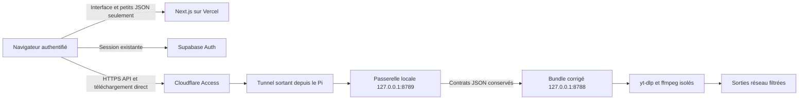
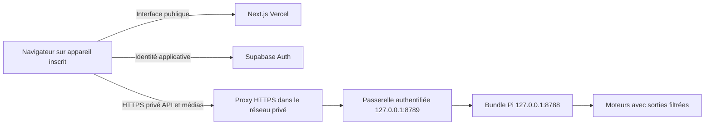

# Accès sécurisé VidFetch — proposition, aucune publication

## Recommandation

Pour l'usage personnel sans abonnement de traitement vidéo : **réseau privé authentifié + passerelle applicative locale**, par exemple Tailscale Serve en HTTPS privé (sans Funnel), ou Cloudflare Private Network avec clients WARP et politiques adaptées. Le navigateur inscrit au réseau privé télécharge directement depuis le Pi ; Vercel sert l'interface et Supabase conserve l'identité applicative. Le backend corrigé reste sur `127.0.0.1:8788` ; une nouvelle passerelle sur `127.0.0.1:8789` vérifie l'identité et les tickets. Aucun port forwarding du routeur n'est prévu. La configuration exacte du réseau privé et son coût doivent être validés avant choix.

**Cloudflare Tunnel public + Access + auth applicative** est étudié comme alternative, avec un prérequis commercial réel : la documentation Cloudflare indique que les routes hostname publiques des plans Free, Pro et Business nécessitent un service payé adapté pour servir vidéos/gros fichiers. Access et le cache désactivé ne lèvent pas cette restriction. Les routes réseau privées en sont exclues. Un tunnel public gratuit n'est donc pas recommandé comme chemin des médias de VidFetch. [FAQ Tunnel](https://developers.cloudflare.com/cloudflare-one/faq/cloudflare-tunnels-faq/), [politique de diffusion vidéo](https://developers.cloudflare.com/fundamentals/reference/policies-compliances/delivering-videos-with-cloudflare/).

**État : architecture préparée, passerelle/authentification et politique de sortie non implémentées ni testées.** Aucun tunnel, DNS, règle Access, secret, compte externe ou paramètre Vercel/Supabase n'a été créé. `cloudflared` est absent du Pi. La configuration exemple contient volontairement des valeurs à remplacer ; elle n'est pas déployable en l'état.

L'inspection ciblée de `src/` et `package.json` ne trouve actuellement ni SDK Supabase ni appel de session Auth. L'usage d'une identité Supabase dans cette proposition est donc une **cible à confirmer**, pas une authentification déjà vérifiée dans le frontend. Vérifier les services et le mode Auth réellement existants sans changer leurs réglages ; si une connexion utilisateur doit être ajoutée au frontend, la prévoir explicitement avant publication. Aucun secret ou fichier d'environnement n'a été affiché pour cette étude.

Schéma de la **variante publique conditionnelle**, à envisager seulement après choix d'une offre appropriée et accord :

Les octets volumineux passent navigateur ↔ Cloudflare ↔ Pi, jamais par une Function Vercel. Vercel documente une limite de payload de Function de 4,5 MB ; ce choix évite aussi son rôle de relais et sa consommation liée au transfert. [Limites Vercel](https://vercel.com/docs/functions/limitations).

## Comparaison

| Solution | Authentification et chemin du fichier | Adéquation / limites |
| --- | --- | --- |
| Réseau privé VPN/mesh, sans publication | Client inscrit au réseau + auth applicative ; navigateur directement vers Pi via réseau privé | **Recommandé initialement** pour le propriétaire/petit groupe. Client VPN et HTTPS/CORS nécessaires sur chaque appareil. Vercel n'entre pas dans le réseau privé. Aucune installation VPN n'est faite. |
| Tunnel + Access + passerelle applicative | Access contrôle l'accès ; la passerelle vérifie aussi l'identité Supabase et l'appartenance des tickets ; fichier directement depuis Pi | Alternative pour un groupe autorisé, sous réserve d'une offre permettant les médias. Deux sessions et un domaine contrôlé nécessaires ; cookies/CORS et délais à tester. |
| Tunnel + auth applicative, sans Access utilisateur | Chaque endpoint est protégé par une session Supabase validée à la passerelle ; fichier directement depuis Pi | À envisager pour une application destinée à de nombreux utilisateurs Supabase. Plus de responsabilité dans la passerelle, contrôle d'abus et quotas ; aucune route publique anonyme. Access pourrait protéger seulement l'administration. Ce choix exige un autre accord. |
| Tunnel + Access seul | Session Access autorisée, fichier directement depuis Pi | Insuffisant pour l'autorisation fine : le bundle actuel traite ses tickets comme porteurs et ne les lie pas à un utilisateur. Ajouter la passerelle. |
| Relais des fichiers via Vercel | Function Vercel transporte les octets | Écarté par la contrainte de la mission. Les petites requêtes d'identité/contrôle peuvent utiliser Vercel si nécessaire ; aucun fichier n'y transite. |

Les quotas et fonctionnalités des plans doivent être confirmés avant adoption. « Tunnel sans port entrant » ne signifie pas absence de publication : un hostname HTTPS public sera accessible derrière authentification. Aucun contournement des restrictions CDN n'est proposé.

## Variante privée recommandée : mise en œuvre à préparer après choix

Tailscale Serve peut relayer un service loopback vers les seuls appareils du tailnet ; le mode proxy vise `http://127.0.0.1`. Utiliser ce proxy HTTPS uniquement vers la passerelle 8789, jamais directement vers le backend non authentifié. Configurer des ACL limitées aux utilisateurs/appareils approuvés, sans annoncer de sous-réseau entier, sans exit node ni Funnel public. La passerelle reste inaccessible directement au LAN et à Internet. Les headers d'identité du proxy ne sont acceptables qu'à cette frontière locale ; compléter par la validation de l'identité Supabase pour l'appartenance des tickets. [Tailscale Serve](https://tailscale.com/docs/features/tailscale-serve), [proxy loopback](https://tailscale.com/docs/reference/tailscale-cli/serve).

Les petits appels de contrôle navigateur portent le Bearer Supabase et utilisent CORS limité à l'origine Vercel autorisée. Pour le GET attachment, ouvrir un helper de premier niveau sur le hostname privé : le frontend transmet token et access token utilisateur par `postMessage` avec origine/source exactes ; le helper effectue un échange d'identité same-origin et reçoit un cookie host-only HttpOnly/Secure court. Le ticket n'est pas envoyé dans une URL de login. La navigation au flux est ensuite same-origin et authentifiée ; aucune mise en mémoire du fichier complet. Tester aussi les permissions d'accès réseau privé du navigateur depuis une page Vercel publique, HTTPS, cookies, fenêtre popup et retour de statut. Ces comportements ne sont pas encore validés.

Une alternative Cloudflare WARP/Private Network utilise une route privée et des politiques utilisateur/appareil, sans hostname public transportant les médias. Elle exige de concevoir le routage privé vers la passerelle : une route vers l'IP LAN du Pi ne joint pas automatiquement un service lié seulement à 127.0.0.1. Prévoir un proxy privé dédié ou une liaison isolée au connecteur, après accord réseau, sans exposer 8788. Ne pas transposer directement le YAML public préparé à cette variante. [Routes privées Cloudflare](https://developers.cloudflare.com/cloudflare-one/networks/connectors/cloudflare-tunnel/private-net/cloudflared/).

Les quotas, l'autorisation propriétaire et l'isolation SSRF décrits plus bas restent obligatoires même dans le réseau privé. Les contrôles JWT Access ci-dessous concernent la variante Tunnel publique ; l'inscription réseau privée et les ACL les remplacent à la frontière réseau dans la variante privée, pas la validation applicative Supabase.

## Identité et navigateur

Choisir, après accord, un domaine contrôlé commun : par exemple `app.example.net` sur Vercel et `download.example.net` derrière Access. Ces domaines sont illustratifs. Un site `*.vercel.app` et un domaine tiers présentent davantage de problèmes de cookies cross-site.

1. La politique Access autorise seulement les personnes approuvées, idéalement avec MFA ; aucune règle Bypass sur l'API ou les téléchargements. Protéger tout le hostname, y compris les helpers et health. Prévoir une navigation de login Access avant les appels API ; une redirection de login dans `fetch` n'est pas un échange API réussi.
2. `cloudflared` doit exiger et vérifier le JWT Access avec `originRequest.access.required: true`, équipe et audience explicites. La passerelle le revérifie (signature, issuer, audience, expiration) avec un cache JWKS borné et une limite de rafraîchissement. Ne pas faire confiance à un simple header d'identité ; interdire toute autre entrée réseau. [Paramètres d'origine](https://developers.cloudflare.com/tunnel/reference/origin-parameters/), [validation JWT Access](https://developers.cloudflare.com/cloudflare-one/access-controls/applications/http-apps/authorization-cookie/validating-json/).
3. Si Supabase Auth est effectivement utilisé, la session fournit un access token utilisateur. Une route locale `POST /auth/session`, bornée à 8 KiB, échange ce token vérifié contre une session opaque courte `HttpOnly; Secure; SameSite=Lax`, cookie host-only. Session liée à `sub` Supabase et à l'identité Access validée ; les deux identités doivent correspondre à une association explicitement autorisée. Aucune clé `service_role`, aucun token de service Cloudflare dans le navigateur. Aucune nouvelle table Supabase n'est requise pour la proposition.
4. Vérifier le JWT Supabase via ses clés publiques si le projet utilise une signature asymétrique, sans changer sa configuration. Pour un projet encore en HS256, utiliser la validation Auth serveur documentée plutôt qu'exposer le secret de signature ; prévoir timeout et quota. Ne pas supposer le mode actuel du projet. Exiger issuer, audience du projet, expiration, sujet authentifié et absence d'identité anonyme non autorisée. [JWT Supabase](https://supabase.com/docs/guides/auth/jwts).
5. Les POST de contrôle utilisent la session ou le Bearer, `credentials: include` si cookie, origine exacte et protection CSRF. La session courte est renouvelée avant préparation ; sa durée doit couvrir au moins le démarrage du téléchargement, sans prolonger le ticket.
6. Configurer CORS sur Access et la passerelle avec l'origine exacte, credentials, méthodes et headers précis. L'OPTIONS est traité sans lancer le moteur et sans lire de ticket ; les requêtes réelles restent authentifiées. Access peut répondre lui-même au preflight. Tester Safari et les cookies tiers : le navigateur ne joint pas ses cookies aux OPTIONS. Aucun `*` avec credentials. [CORS Access](https://developers.cloudflare.com/cloudflare-one/access-controls/applications/http-apps/authorization-cookie/cors/).

Le bundle actuel refuse les origines distantes et les Host publics. La passerelle vérifie l'origine externe, puis reconstruit l'appel interne avec `Host: 127.0.0.1:8788` et sans `Origin`, ni Cookie, Authorization ou headers proxy fournis par le client. C'est une frontière d'authentification explicite ; ne pas simplement retirer ces headers dans un tunnel qui pointerait directement sur 8788.

## Protection des tickets et du flux

La passerelle doit conserver les contrats existants `{url}`, `{url, format_id, type}`, réponse 201 `{ok, token, filename, downloadUrl}` et statut `{ok,status,bytes,error}`. Les tokens publics deviennent des identifiants aléatoires opaques (au moins 128 bits), mappés vers le token interne et le propriétaire authentifié. Ne pas exposer le token interne hors du Pi.

- La session et le propriétaire sont vérifiés avant le GET de statut ou de ticket. Un autre utilisateur reçoit 404 sans pouvoir consommer le ticket. Le map ne contient aucun fichier vidéo et possède un plafond strict, au plus 256 travaux.
- La consommation publique est atomique et à usage unique, puis seulement le ticket interne est consommé. Expiration au plus 60 s après préparation, sans prolongation par consultation ou renouvellement de session. Si le flux échoue, un nouveau POST est nécessaire ; pas de replay ni de Range non prévu par le bundle.
- La rétention de l'association propriétaire/statut couvre la durée de travail et les 30 min après la dernière transition du backend, sans être prolongée par polling. Une borne de 40 min après création couvre la limite totale de travail de 10 min ; la disponibilité réelle reste celle du backend. Purger les entrées au redémarrage ; ne pas recycler leur identifiant.
- Utiliser une navigation directe authentifiée vers le GET de téléchargement avec cookie : le navigateur enregistre progressivement l'attachment. Éviter `response.blob()` pour une grosse vidéo. Pour un hostname distinct, fournir si nécessaire une petite page helper authentifiée sous ce hostname : ouvrir la page sans token sensible en query, recevoir le ticket en `postMessage` avec origine/source exactes, puis naviguer vers le flux. Le helper reste derrière Access et la session applicative.
- Le ticket reste dans l'URL finale pour conserver le contrat GET, mais n'est pas suffisant sans session propriétaire. `Referrer-Policy: no-referrer`, cache désactivé sur les routes API/stream, aucun log de query/token/cookies/Authorization, pas d'outil d'analytics sur le helper. Vérifier que l'edge n'enregistre pas ces valeurs ; les journaux Access/Cloudflare peuvent conserver des métadonnées et exigent une politique de rétention.
- Le proxy transmet les chunks avec backpressure, timeout d'inactivité 30 s et propagation de l'abandon client jusqu'à 8788. Aucune compression, buffering complet, Range ou reprise automatique sur un ticket consommé. La passerelle compte les octets réellement transmis et conserve la limite 256 MiB.

## Quotas proposés et délais

Valeurs initiales à valider : une opération moteur globale, cinq préparations par utilisateur/heure, vingt extractions par utilisateur/heure, polling au plus une fois par deux secondes, et limite supplémentaire par IP provenant uniquement d'un proxy vérifié. Maps de quotas et sessions bornées ; refuser l'accès lorsque pleines plutôt que croître sans limite. Retourner 429 avec `Retry-After` approprié.

Conserver corps 8 KiB/10 s, métadonnées 2 MiB/75 s, premier morceau 90 s, ticket 60 s, travail 10 min, inactivité 30 s, sortie 256 MiB et durée média déclarée 30 min. La préparation cumule extraction et premier morceau : **75 + 90 = 165 s** au pire pour ces seules étapes, au-delà du timeout de lecture Cloudflare documenté actuellement à **125 s**. Les résolutions DNS/validations et, pour Instagram, jusqu'à cinq redirections de 15 s sont des étapes supplémentaires ; les 75 s bornent la commande yt-dlp de métadonnées, pas tout le POST. La publication nécessite un budget global couvrant toutes les étapes sous la limite edge, ou un protocole de job/polling à valider avec le frontend. Ne pas prétendre que le Tunnel résout ce délai. Tester aussi un transfert long à faible débit et la coupure du client ; le timeout de lecture concerne l'absence de données, pas nécessairement la durée totale d'un flux actif. [Erreur 524 Cloudflare](https://developers.cloudflare.com/support/troubleshooting/http-status-codes/cloudflare-5xx-errors/error-524/).

## SSRF : sortie des moteurs, condition préalable à toute exposition

Le bundle vérifie les URL d'entrée, les résolutions DNS initiales et les destinations des métadonnées sélectionnées. Cet audit confirme toutefois qu'il ne contrôle pas chaque redirection, nouveau DNS, URL de manifest ou sous-requête faite dans yt-dlp/ffmpeg. Le whitelist de protocoles ffmpeg restreint les schémas, pas les adresses IP. Le proxy d'entrée et Access n'empêchent pas ces sorties.

Préparer une isolation **propre à VidFetch**, sans règle globale affectant SSH/8787 : namespace réseau ou proxy de sortie imposé au compte/cgroup moteur. Les moteurs doivent n'avoir aucun accès direct réseau qui contourne le proxy ; régler seulement `HTTP_PROXY` ou `YTDLP_PROXY` ne suffit pas. Séparer le backend/passerelle capables de communiquer en loopback du moteur dont le loopback ne doit pas atteindre les services de l'hôte.

La politique doit refuser IPv4 et IPv6 loopback, RFC1918, link-local et metadata, CGNAT, plages réservées/multicast et réseau local ; limiter ports 80/443 et DNS à un résolveur contrôlé. Au proxy, valider l'hôte/CDN autorisé, résoudre toutes les adresses, refuser un ensemble mêlant adresse privée/publique, fixer la destination de connexion à l'adresse validée et refaire le contrôle à chaque nouvelle connexion/redirection. Un proxy CONNECT doit appliquer ces contrôles à chaque tunnel et refuser les ports/hôtes arbitraires. Pour inspecter les redirections applicatives chiffrées, préférer un fetcher contrôlé ou des changements moteur qui exposent chaque destination ; un simple contrôle des IP ne prouve pas l'allowlist des chemins HTTP.

Ces règles doivent couvrir également un downloader ffmpeg secondaire et le runtime JS enfant. Mesurer le coût sur Pi 3 ; ne pas installer de container lourd par défaut. Voir les défenses applicatives et réseau [OWASP SSRF](https://cheatsheetseries.owasp.org/cheatsheets/Server_Side_Request_Forgery_Prevention_Cheat_Sheet.html).

Tests adverses à exécuter dans un environnement isolé avant accord de publication : redirection publique vers privé ; DNS rebinding ; mixed A/AAAA ; URL relative de segment HLS privée ; manifest imbriqué ; accès file/ftp/Unix ; CDN ou port non autorisé ; runtime/ffmpeg tentant loopback de l'hôte ; panne du DNS/proxy ; absence de contournement IPv6. Ne pas lancer d'attaque contre les services réels 8787 ou SSH pour ces tests.

## Modifications nécessaires et critères avant déploiement

1. Nouvelle passerelle locale, validation des deux identités, sessions/quota bornés et autorisation des tickets ; tests d'accès croisé, JWT falsifié/expiré/audience incorrecte, CSRF, OPTIONS, saturation, replay, abandon et backpressure. Le bundle Pi validé reste inchangé pendant cette mission.
2. Politique de sortie effective des moteurs et tests SSRF ; adaptation éventuelle du spawn pour rejoindre leur isolation. Cela demande un nouvel artefact et une validation, puis accord pour les changements réseau.
3. Frontend : choisir une base API directe vers la passerelle, conserver les contrats et le polling, établir la session applicative, ouvrir le téléchargement direct ; pas de route Vercel portant les octets. Ces modifications sont spécifiées ici, pas appliquées au frontend déployé.
4. Résoudre le budget de préparation au regard de l'edge et valider le service systemd, dont le contrôleur mémoire absent. Mesurer de nouveau RAM avec passerelle et cloudflared ; leur coût n'est pas inclus dans les 195,6 MiB historiques.
5. Après accords séparés : installation/configuration du réseau privé choisi, HTTPS et ACL, puis validation navigateur distant et flux sans octets par Vercel. Pour l'alternative publique seulement : offre média appropriée, domaine/DNS, installation cloudflared, Access deny par défaut, règles cache/CORS et secrets locaux privés. Aucune de ces actions n'est exécutée.

L'architecture est une recommandation technique issue des contraintes et des documentations citées ; elle n'est pas une validation de production.

## Points d'intégration vérifiés dans le code actuel

| Fichier actuel | Modification future nécessaire |
| --- | --- |
| `src/lib/api.ts` | `NEXT_PUBLIC_API_ORIGIN` existe déjà et permet l'accès direct navigateur. Ajouter l'identité/session aux petits appels et `credentials: include` lorsque les cookies cross-origin sont utilisés. Ne pas mettre de secret dans une variable `NEXT_PUBLIC_*`. Restreindre `downloadUrl` au chemin de la passerelle approuvée : `apiUrl` accepte actuellement toute URL HTTP absolue. |
| `src/components/FetchForm.tsx` | Établir la session Access/applicative avant `postJson('/api/fetch-info')`, traiter 401/403 et la reconnexion sans boucle automatique. |
| `src/components/VideoCard.tsx` | Conserver POST de préparation et polling de statut, ajouter les credentials à ce dernier. Le téléchargement utilise déjà une ancre, sans `blob()`. Son `target=frameName` doit être revu : le login Access dans un iframe caché peut être interdit. Utiliser une navigation/helper de premier niveau après authentification, puis le flux attachment. Valider l'origine et le chemin du lien ; ne pas relancer un ticket déjà consommé. |
| `backend/server.ts` / bundle Pi | Aucun changement pendant cette mission. Host/Origin restent strictement locaux ; seule la passerelle autorisée reconstruit les requêtes internes. Un nouveau bundle sera requis si le budget de préparation ou l'isolation moteur demande une correction. |
| Nouvelle passerelle sur Pi | Routes et états conformes au contrat, deux identités vérifiées, autorisation propriétaire, map bornée, quotas, CSRF/CORS, GET streaming avec backpressure et déconnexion. Aucun routage vers une URL fournie par l'utilisateur. |

La route de partage Instagram est limitée à cinq redirections manuelles reconnues comme Instagram, mais la connexion ultérieure n'est pas liée à une IP DNS validée. `validateMediaDestinations` inspecte les URL/fragments présents dans les métadonnées ; le moteur continue à résoudre et télécharger les manifests/sous-requêtes. Ce constat justifie l'isolation de sortie proposée, sans présenter le contrôle Node comme une garantie complète.
