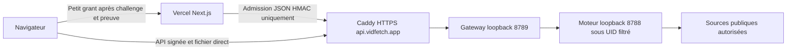

# VidFetch — instance OVH locale, 12 octobre 2026

## 1. Résultat et état initial

**VALIDÉ : installation autonome et services en loopback sur le VPS OVH `15.235.127.165`. Aucune activation HTTPS publique.** Le Raspberry Pi est préservé : aucun SSH, transfert ou changement de ses services. Vercel, Supabase et Cloudflare ne sont pas modifiés. Aucun commit, push, merge ou reboot.

**BLOQUÉ : téléchargement YouTube depuis cette adresse OVH**, demande de vérification anti-bot. L'installation et les tests du moteur ne constituent pas une validation de toutes les plateformes. La bascule du frontend doit attendre un vrai essai Preview de bout en bout sur un média accessible et autorisé.

Branche locale `work/vidfetch-secure-connection-20261012`, base `cf8cc173130f9832f2ca776c6fda563e67a6d9fb`; `main` reste `d572cf89d790d73b7102d2fb4e308977f79cafbb`. Les modifications de connexion sécurisée et de file existantes restent présentes, non commitées. La décision OVH remplace le pilote gratuit Pi/Funnel comme cible future ; les rapports précédents sont conservés comme historique.

Audit SSH par clé ED25519, `BatchMode=yes`, vérification de clé hôte stricte : Debian **13.6**, noyau **6.12.100+deb13-cloud-amd64**, **x86_64**, **2 vCPU**, **3 826 MiB RAM**, initialement **3 516 MiB disponibles** ; volume racine 40 Go, 37 Go libres affichés, aucun swap. Node/yt-dlp/ffmpeg absents, 8788/8789 libres. SSH PID **869** actif ; écoute existante SSH 22, resolved 5355 et DNS loopback 53 conservée. Aucun service en échec au début. Contrôleurs cgroup CPU/memory/pids disponibles. nft CLI absent au début ; aucun pare-feu entrant global n'a été activé ou remplacé.

## 2. Modifications effectuées

- Dépendances Debian nécessaires via APT signé, sans mise à niveau globale ni suppression/autoremove.
- Node officiel sous `/opt/vidfetch/tools/node-v22.23.3-linux-x64/` ; commandes `/usr/local/bin/node`, `npm`, `npx` créées seulement après absence de tout fichier/lien existant.
- yt-dlp épinglé et root-owned ; distribution compacte initiale conservée, puis distribution officielle décompressée retenue pour éviter les résidus après SIGKILL. Aucun pip système, aucun téléchargement automatique de composants JS activé, aucune mise à jour automatique yt-dlp.
- Comptes système `vidfetch-worker` (UID **999**) et `vidfetch-gateway` (UID **995**), groupes distincts, shell nologin.
- Nouvelle release `/opt/vidfetch/releases/ovh-20261012-rnllrb69-ipv4/`; précédente release conservée.
- Configuration root `/etc/vidfetch/`; fichiers `worker.env`/`gateway.env` **0600**, clé aléatoire 32 octets générée sur VPS, jamais affichée/transférée dans le dépôt. État privé dans `/var/lib/vidfetch-worker` et `/var/lib/vidfetch-gateway`.
- Locale `en_US.UTF-8` générée pour supprimer l'avertissement SSH ; locale du service `C.UTF-8`, aucune modification de sshd/default locale.
- **Aucun swap ajouté** : 4 Go physiques, plafond moteur 1 Gio, une opération, mesures très inférieures au plafond. Réévaluer uniquement si pression mémoire/OOM mesurée.

Sauvegardes avant remplacement de nos configurations : `/opt/vidfetch/backups/before-ipv4-20261012/`, `before-policy-fingerprint-20261012/`, `before-unpacked-ytdlp-20261012/`. Aucun fichier préexistant étranger à cette installation n'a été écrasé ou supprimé. Les seuls fichiers retirés sont l'override systemd temporaire créé par les tests et son dossier vide ; systemd nettoie les espaces PrivateTmp des unités arrêtées.

## 3. Dépendances finales et mises à jour

| Élément | Version / chemin | Résultat |
|---|---|---|
| Node | **22.23.3**, distribution Linux x64 officielle | **VALIDÉ**, exécution VPS |
| yt-dlp | **2026.08.19**, `/opt/vidfetch/tools/yt-dlp-2026.08.19-unpacked/yt-dlp_linux` | **VALIDÉ**, version et vrais téléchargements |
| ffmpeg + ffprobe | **7.1.5-0+deb13u1**, `/usr/bin/` | **VALIDÉ**, conversion et décodage |
| nftables | Debian 1.1.3 | **VALIDÉ**, politique UID et rechargement |
| Locale | en_US.UTF-8 et C.UTF-8 | **VALIDÉ**, avertissement initial corrigé |

Node tar SHA-256 : `df450af89261115ef9f9e3830c3eeb2cc9213b63c720b1af623cb5dcbe2e02de`.
yt-dlp ZIP SHA-256 : `32e72032766bef9199d99d15beb69fd52e46df8f8b06f0d8745db59e04d339e9`.
Sommes vérifiées contre les manifests officiels récupérés par HTTPS ; vérification GPG des manifests **NON TESTÉE**, ne pas les présenter comme signatures vérifiées. La [documentation yt-dlp](https://github.com/yt-dlp/yt-dlp#release-files) décrit la distribution Linux décompressée et son absence d'auto-update ; les composants EJS sont inclus dans les distributions PyInstaller et [Node 22 est un runtime pris en charge](https://github.com/yt-dlp/yt-dlp/wiki/EJS). [Manifest Node officiel](https://nodejs.org/download/release/v22.23.3/SHASUMS256.txt).

Mise à jour manuelle : choisir une version officielle précise, télécharger dans un **nouveau** répertoire, contrôler checksum/signature, version et tests, sauvegarder l'environnement/unité, modifier le chemin épinglé, redémarrer uniquement VidFetch et contrôler santé/processus. Garder l'ancienne version pour rollback. Ne pas lancer `yt-dlp -U` dans un processus applicatif et ne pas modifier les fichiers de release en place.

## 4. Code et compilation

Source partagée actuelle conservée : correction MP3 `-abort_on empty_output` déjà préparée, itérateur unique, nettoyage des timers, backpressure, attente de la sortie zéro des enfants avant `completed`, erreurs 400/413/504 préservées.

Ajouts limités : `backend/ovh/main.ts`, contrôle de profil UID root `isolation.ts`, compilateur `build.mjs`, tsconfig, entrée de fixture **réservée aux tests** ; choix `YTDLP_FORCE_IPV4=1` dans `engineContext`, reconnaissance explicite du profil `vidfetch-uid-nft-v1` dans la passerelle. Mode netns/Pi conservé par défaut. Le filtrage IPv6 volontaire causait le premier timeout ; la sélection IPv4 ramène l'erreur YouTube à quelques secondes. Aucun mécanisme HTTP/env de production ne permet d'injecter les métadonnées de fixture.

esbuild **0.25.12**, `bundle:true`, `platform:node`, `target:node22`, `format:cjs`, shim ffmpeg-static null. Bundle JS indépendant de l'architecture ; outils natifs Linux **x86_64**, exécution réellement vérifiée sur VPS. Aucun node_modules Next/PostgreSQL/Supabase nécessaire au runtime.

- Moteur final : **54 094 octets**, SHA `fa0d3d4e15a5a45ca0deb2b35e7ba03adc95c31b87500378068121f291c42287`.
- Passerelle : **41 610 octets**, SHA `a703f269641fc6c38fce74d4e7ff7f47ef5fe54a64b3e104dbab2082481dc1d5`.
- `node --check` Mac et VPS : **VALIDÉ** ; imports du bundle moteur uniquement builtins Node, aucun chemin Mac ni dépendance native Darwin.
- ESLint, TypeScript Next et programmes backend/gateway/OVH : **VALIDÉ**. Typecheck externe backend fait explicitement.
- **88/88 unitaires, 17/17 backend, 3/3 charge/expiration de queue** : **VALIDÉ**. Échecs sandbox `EPERM` résolus par relance autorisée avec sockets loopback. Les builds Next sans DATABASE_URL/.env et tests Chrome/HTTPS déjà validés sont conservés ; frontend inchangé pendant cette migration, pas de nouveau build Next annoncé.

## 5. Tests VPS, portée et preuves

Répertoire distant de validation : `/home/debian/vidfetch-ovh-20261012-LdnrtQwN`.
Preuves Mac privées et sauvegardes : `backend/artifacts/ovh-deployment-20261012-rnllrb69/` (ignoré par Git). Résumé maintenable : `backend/validation/ovh-vps-20261012.json`.

**Les téléchargements positifs utilisent les fonctions backend partagées et la passerelle installée sous les protections réelles, avec des métadonnées de fixture injectées uniquement dans une entrée temporaire.** Métadonnées obtenues par le vrai yt-dlp Generic puis complétées avec les codecs confirmés par ffprobe. URL d'entrée de contrat YouTube conservée dans le test ; source réelle **[bande-annonce Big Buck Bunny W3C](https://media.w3.org/2010/05/bunny/trailer.ogv)**. Attribution : © 2008 Blender Foundation / www.bigbuckbunny.org, CC BY 3.0 ([licence](https://wiki.creativecommons.org/wiki/Big_Buck_Bunny)). Les résolutions et destinations réseau ne sont pas désactivées ; vrais yt-dlp et ffmpeg exécutés sous UID filtré. Les en-têtes HTTPS/Caddy sont simulés sur le transport loopback pour l'authentification. **Pas de TLS public ni de succès YouTube déduit de la fixture.**

| Contrôle | Verdict / preuve |
|---|---|
| Santé permanente et moteurs | **VALIDÉ**, HTTP 200, profil UID nft, absence de marqueur fixture après restauration |
| HTTP / JSON / taille / type / URL privée / méthodes | **VALIDÉ**, 400, 413, 405 et 404 attendus |
| Extraction fixture / formats vidéo et MP3 | **VALIDÉ**, contrat HTTP 200 ; injection de test documentée |
| Auth et origine, preuve rejouée, propriétaire de ticket | **VALIDÉ**, 401 / 403 / 404, MAC et P-256 réels |
| Verrou / queue / doublon / owner / annulation | **VALIDÉ**, une opération, 202 puis 429 pour doublon, pas de moteur sur annulation |
| Vidéo complète | **VALIDÉ**, **4 360 399 octets**, Theora + Vorbis, durée **32,996875 s**, ffprobe et décodage intégral zéro |
| MP3 complet | **VALIDÉ**, **792 620 octets**, codec MP3, durée **33,024 s**, ffprobe et décodage intégral zéro |
| Compteur / completed / ticket usage unique | **VALIDÉ**, octets exacts et ticket consommé 404 |
| Expiration réelle | **VALIDÉ**, attente **61,5 s**, expired/404 et libération de la place |
| Déconnexion / processus | **VALIDÉ**, aborted, enfants moteurs absents ; aucun override temporaire laissé actif |
| Rétention de statut | **VALIDÉ** après consommation ; 30 minutes configurées et tests antérieurs conservés, attente réelle de 30 minutes sur VPS **NON TESTÉE** |
| YouTube réel production | **BLOQUÉ**, HTTP **401 AUTH_REQUIRED**, contrôle anti-bot depuis OVH ; aucune session/cookie/proxy ajouté |
| Privé / metadata / IPv6 / port sortant interdit | **VALIDÉ**, six sondes sous UID moteur, SSH inchangé |
| Redirection publique vers canary privé | **BLOQUÉ**, sites de redirect de test indisponibles (HTTP 503 notamment) ; zéro accès au canary ne prouve pas le suivi du redirect |
| HTTPS public / Vercel Preview / autres plateformes | **NON TESTÉ**, activation volontairement absente |

SHA vidéo : `dcbe6f2ea404a52d4b2f6fc91f274874e69be1671a1097eb3dc19f28f7c6e40f`.
SHA MP3 : `38b23dc423846fff16d0d88950390ace9e9d3152d871ea8d0d0f9f676bd69ecf`.

Échecs intermédiaires conservés : premier client Node fetch ignore le Host personnalisé (corrigé **dans le client de test** avec http.request) ; première fixture MP4 sans audio rejetée par le test ; sources déplacées/absentes, Ogg W3C retenu ; limite anti-boucle systemd atteinte par les démarrages contrôlés, reset ciblé ; empreinte nft avec handles volatils corrigée ; résidu d'extraction compacte constaté après SIGKILL (**85 470 495 octets**) corrigé par distribution décompressée ; quota de huit demandes de l'IP synthétique initiale réellement atteint (**429 QUOTA_EXCEEDED**, vérifié séparément), conservé, identités synthétiques neuves pour fin de validation. Aucun de ces essais ratés n'est présenté comme validation positive.

## 6. Ressources mesurées

Sonde `/proc` + cgroup toutes les **500 ms**, uniquement familles des deux UID dédiés. Premier scénario complet : **48/48**, pic RSS agrégée **257,1 Mio**, cgroup moteur **226,5 Mio**, passerelle **20,6 Mio**, CPU moteur **7,00 s**, passerelle **0,63 s** ; max intervalle moteur **101,9 % d'un cœur**, passerelle **24,8 % d'un cœur** (maxima séparés, ne pas additionner). Temps total préparation + réception + contrôle : vidéo **6,125 s**, MP3 **4,219 s**.

Avec la distribution décompressée, vidéo **3,842 s**, MP3 **3,553 s**, mêmes octets/SHA ; pic RSS familles **256,9 Mio**, cgroup moteur **84,2 Mio**, passerelle **20,1 Mio**, CPU moteur **4,05 s** dans l'essai ensuite arrêté par le quota attendu. La vérification SIGKILL spécifique retourne **0 répertoire d'extraction, 0 octet résiduel**. Dernier scénario avec distribution finale : **48/48**, vidéo **3,837 s**, MP3 **3,407 s**, pic RSS familles **254,1 Mio**, cgroup moteur **83,0 Mio**, gateway **19,5 Mio**, CPU moteur **4,628 s**, gateway **0,609 s** ; max intervalle CPU moteur **116,7 % d'un cœur**, gateway **21,0 %**. Les mesures détaillées sont dans le JSON de validation. Ces petits médias et la réception loopback ne mesurent ni débit public OVH, ni capacité de production, ni gros fichiers/HLS/DASH.

Snapshot après cycle systemd : **3 379 MiB disponibles**, racine 36 Go libres, swap toujours absent. Après recharge de politique : **3 420 MiB disponibles**. Aucun chiffre de visiteurs/jour garanti. Limites applicatives et quotas priment ; 100 tentatives/jour et 4 Gio/jour ne signifient pas 100 fichiers de 256 Mio autorisés.

## 7. Sécurité appliquée

- Moteur **127.0.0.1:8788**, passerelle **127.0.0.1:8789** ; aucune écoute 80/443 ajoutée. Raw backend est une API **privée locale**, sans auth propre ; seul le gateway authentifié sera routé ultérieurement par Caddy.
- Table **inet vidfetch_egress**, hook output avec politique accept globale, **jump uniquement skuid 999**. Aucun flush ruleset, INPUT global, changement réseau/interface/kernel/SSH. Les autres UID, dont debian/root/sshd, restent hors de cette politique.
- Pour le moteur et ses descendants : connexions établies de réponse permises ; nouvelles destinations privées/réservées/metadata/loopback rejetées, IPv6 sortant rejeté, DNS uniquement au résolveur OVH public 213.186.33.99:53, TCP public 80/443 uniquement. Cela couvre les nouvelles connexions de yt-dlp/ffmpeg lors des redirections et requêtes secondaires, même après résolution DNS. Le test de redirect complet reste bloqué, sans prétendre l'avoir validé.
- Profil root et règles root-readonly, UID distinct, CapEff=0 et NoNewPrivs exigés ; refus d'hériter cookies/proxy. Attestation administrative, pas un lecteur nft privilégié dans Node. L'unité root vérifie **structure et ordre des règles**, sans handles/compteurs volatils. `BindsTo` arrête le moteur quand son garde s'arrête ; arrêt/recréation/vérification testés, sans reboot.
- URL strictes des quatre plateformes, canonicalisation, DNS public préflight, inspection des destinations sélectionnées, paramètres de format bornés, spawn tableaux sans shell.
- API gateway : JWT HMAC **120 s**, preuve P-256 liée méthode/query/corps/grant, nonce anti-rejeu et quotas SQLite persistants. Un visiteur anonyme autorisé est une identité de session, pas un compte Supabase vérifié. Turnstile réel et issuer Vercel **NON TESTÉS ici**.
- Ticket extérieur **55 s**, source **60 s**, cookie bref Secure/HttpOnly/SameSite Strict + IP/propriétaire ; expiration conserve le verrou jusqu'au nettoyage source. Cookie/grant/URL signée jamais dans les journaux applicatifs. CORS ne constitue pas l'authentification.
- Queue **2 places**, 1 pending par propriétaire/IP, FIFO, attente absolue **180 s**, heartbeat **20 s**, claim **15 s**, estimation **90 s** à recalibrer par mesures. Statuts **30 min** ; jobs limités.
- Une opération yt-dlp/ffmpeg, taille **256 Mio**, durée annoncée **30 min**, opération **600 s**, metadata **75 s**, premier morceau **90 s**, idle **30 s**, corps **8 Kio / 10 s**, média progressif sans fichier entier en RAM.
- Rate **120 requêtes/min/IP**, **20 opérations/10 min/IP et propriétaire**, **8 tentatives/jour/IP et propriétaire**, **100 globales/jour**, **1 Gio/jour/IP et propriétaire**, **4 Gio/jour globalement**, réservation conservatrice persistante. Tests comptent dans les quotas ; aucune base de quota effacée.
- Clé SSH validée ; passwordauthentication et permitrootlogin d'origine laissés inchangés. Confirmer console/récupération OVH avant tout durcissement futur de SSH. Pare-feu entrant global et règles 80/443 futures : préparer et tester séparément avec session SSH de secours.

## 8. État systemd

**VALIDÉ**, unités installées et enabled : `vidfetch.service`, `vidfetch-gateway.service`, `vidfetch-egress.service`. Journaux journald ; aucun service Pi modifié.

Moteur : heap 192 Mio, **MemoryHigh 768 Mio / MemoryMax 1 Gio / MemorySwapMax 0**, CPU **150 %**, TasksMax **128**, Nice 10 ; gateway heap 96 Mio, High 192 Mio / Max 256 Mio, CPU **50 %**, TasksMax **64**. Restart on-failure **10 s**, trois démarrages par fenêtre de 300 s ; stop **30 s**, KillMode control-group.

NoNewPrivileges, caps vides, ProtectSystem strict, ProtectHome, PrivateTmp/Devices, protections kernel et cgroups, RestrictSUIDSGID, familles UNIX/INET/INET6. Résolveur monté en lecture seule seulement dans le moteur. Pas de MemoryDenyWriteExecute incompatible avec JIT Node. État et quota dans StateDirectory 0700.

Cycle réel : **13/13**, stop libère les deux ports et tous les processus worker ; start santé 200 ; SIGKILL de Node avec moteur actif, reprise automatique **11,548 s**, ancien groupe moteur absent, gateway actif ; enabled vérifié, SSH PID 869 inchangé. Après correction nft : arrêt du garde ferme les ports, recréation de politique vérifiée et reprise possibles. Nouveau cycle avec distribution finale : **13/13**, reprise **11.31 s**, mêmes contrôles, PID finaux moteur **9270**, gateway **9271**, SSH **869**. Audit à **2026-10-12T17:11:25Z**, santé 200, trois unités active/enabled, seuls deux Node et aucun `_MEI` ; RAM disponible **3 413 MiB**. `NRestarts=1` correspond au crash volontaire validé, pas à un plantage spontané. **Reboot réel NON TESTÉ**, interdit par la mission.

Exploitation locale :

```sh
ssh -i ~/.ssh/id_ed25519 -o BatchMode=yes -o StrictHostKeyChecking=yes debian@15.235.127.165
curl --fail http://127.0.0.1:8788/api/health
sudo systemctl status vidfetch.service vidfetch-gateway.service vidfetch-egress.service
sudo journalctl -u vidfetch.service -u vidfetch-gateway.service --since '10 minutes ago'
```

L'appel gateway requiert les en-têtes de proxy fiable ET les preuves ; un curl anonyme vers 8789 est rejeté. Ne jamais afficher `gateway.env` dans un terminal partagé ou journal. Un endpoint santé 200 ne prouve pas que YouTube autorise les téléchargements.

## 9. Actions manuelles restantes : HTTPS puis Preview

**Arrêt avant toute activation publique.** Caddy non installé/non démarré ; modèle `ovh/Caddyfile.example` préparé, syntaxe et certificat réels **NON TESTÉS**. Le backend fonctionne indépendamment du Pi ; la Preview actuelle reste au mode dégradé. Le champ historique `service: vidfetch.io` de la santé a été conservé pour le contrat JSON ; ce champ n'est ni une URL de routage ni une modification de domaine.



Après accord public séparé et résolution/acceptation explicite du blocage plateforme :

1. Vérifier une source de plateforme réellement accessible depuis OVH, sans contourner anti-bot, DRM ou accès restreint. Valider gros fichier, interruptions, redirections privées et formats HLS/DASH avant de déclarer une migration complète.
2. Dans Cloudflare DNS, créer **A `api` → 15.235.127.165**, **DNS only / nuage gris**. Pas de tunnel ni CDN pour les fichiers. Ne pas ajouter d'AAAA sans valider HTTPS IPv6 et pare-feu. Les [restrictions Cloudflare sur la diffusion de médias](https://developers.cloudflare.com/fundamentals/reference/policies-compliances/delivering-videos-with-cloudflare/) justifient ce chemin DNS-only.
3. Installer Caddy **sans auto-démarrage initial** (masquer son unité avant installation si nécessaire), sauvegarder toute configuration existante, adapter/valider le modèle, contrôler pare-feu SSH et récupération ; autoriser uniquement 80/443 pour Caddy. Ne jamais ouvrir 8788/8789. Activer le certificat et HTTPS seulement après accord public. Le [reverse proxy Caddy](https://caddyserver.com/docs/caddyfile/directives/reverse_proxy) transmet progressivement sans buffering de fichier entier ; conserver la propagation des déconnexions, écraser Host/X-Forwarded-For/Proto et ne pas activer les logs d'accès avec query tickets.
4. Créer/configurer Turnstile dans votre compte Cloudflare, hostnames exacts du frontend de test, action `vidfetch`. Faire la vérification réelle serveur, sans utiliser le simulacre des tests.
5. Préparer une Preview isolée du **code de travail non poussé** : futur commit/push seulement avec nouvelle autorisation, ou déploiement Preview manuel du code local par l'utilisateur. La release GitHub cf8 actuelle conserve le mode dégradé. Ne pas promouvoir en production.
6. Choisir une URL Preview stable, puis ajouter son origine exacte à `VIDFETCH_SITE_ORIGINS` sur le gateway (sauvegarde + restart ciblé), ainsi que le hostname Turnstile. Aucun wildcard vercel.app. Les changements sont **à faire plus tard**, pas déjà réalisés.
7. Variables **Preview seulement** : `VIDFETCH_TARGET`, `VIDFETCH_CONNECTION_READY`, `NEXT_PUBLIC_API_ORIGIN`, `NEXT_PUBLIC_SITE_URL`, `NEXT_PUBLIC_TURNSTILE_SITE_KEY`, `TURNSTILE_SECRET_KEY`, `VIDFETCH_ACCESS_SIGNING_KEY`. API origin publique future `https://api.vidfetch.app`; site origin = URL Preview exacte. Transférer la clé gateway vers le coffre Vercel par un canal privé, jamais `NEXT_PUBLIC_`; aucune valeur secrète fournie dans ce rapport. Conserver toutes les variables Supabase existantes ; aucune fausse DATABASE_URL nécessaire.
8. Redeployer Preview manuellement après configuration. Dans DevTools : grants/admission JSON petits via Vercel, info/preparation/status et **download helper/fichier vers api.vidfetch.app directement**. Aucun Blob du fichier entier dans React, aucune route Next ne relaie le média. Tester challenge, refus 401/403/429, owner/replay/expiry, fichier/compteur/decode, déconnexion et Pi indisponible : VPS doit rester autonome. Production/Pi ne basculent qu'après preuve de bout en bout.

## 10. Retour arrière et maintenance des preuves

- Arrêter la future intégration Preview en remettant `VIDFETCH_CONNECTION_READY` hors mode actif, puis redeployer uniquement Preview. Production et Pi actuels restent inchangés.
- Pour revenir à la précédente release VPS : sauvegarder la configuration courante, arrêter gateway/moteur, restaurer les chemins/env sauvegardés, `daemon-reload`, démarrer, tester santé et fichier. La première release compacte est un rollback de diagnostic, **ne pas la choisir durablement** à cause des résidus d'extraction.
- Pour désactiver cette nouvelle installation sans supprimer ses données : `sudo systemctl disable --now vidfetch-gateway.service vidfetch.service vidfetch-egress.service`. Dépendances arrêtent le moteur avant retrait de **sa seule table**. Conserver releases, comptes, outils, backups et ledger ; aucune suppression de paquet partagé, SSH, fichier Pi ou service existant.
- Si le garde échoue, ne pas contourner l'attestation ou commenter les protections : arrêter uniquement VidFetch, inspecter `journalctl -u vidfetch-egress`, comparer la spécification root et la structure nft, corriger avec sauvegarde. `reset-failed` ciblé uniquement après résolution ou essais de démarrage contrôlés.
- Les scripts dans `ovh/` documentent les opérations réalisées et leurs préconditions. Certains ciblent les chemins exacts de cette validation ; **ne pas relancer l'installation sur un répertoire existant**. Ils refusent les données/configurations préexistantes. Les artefacts, médias et sauvegardes restent privés/ignorés, caches Python ignorés. Aucun secret dans les sources/rapport selon le scanner ; contrôles ne garantissent pas l'absence universelle de tout secret.
