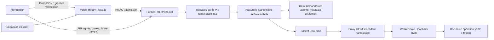

# VidFetch — pilote gratuit sur Raspberry Pi et montée en charge

Audit du **12 octobre 2026**, branche locale `work/vidfetch-secure-connection-20261012`, base `cf8cc173130f9832f2ca776c6fda563e67a6d9fb`. Oracle/VPS est **abandonné temporairement**. Les sources et preuves précédentes sont conservées. Aucun push, sudo, installation, redémarrage, changement Vercel/Supabase, ouverture de port ou Funnel activé.

**Conclusion : préparer un pilote Funnel avec la passerelle authentifiée sur le Pi, commencer à 100 visiteurs/jour et mesurer avant de viser 500.** La capacité Internet de production est **NON VALIDÉE**. Le blocage immédiat est matériel : sous-tension et throttling actifs. Le débit montant reste inconnu ; aucun chiffre mesuré ne permet encore de dimensionner Funnel.

## 1. État réel du Raspberry Pi

Inspection SSH non interactive, en lecture seule, sans installation ni modification des fichiers Pi. `pi-snapshot.mjs` est exécuté depuis stdin et enregistre ses preuves uniquement sur le Mac.

| Mesure du 12 octobre | Résultat et portée |
| --- | --- |
| Architecture / Node | `aarch64`, Node `v22.22.2` |
| Backend actuel | Santé HTTP 200, yt-dlp `2026.08.19`, ffmpeg présent |
| Service | `active`, PID **19166**, `NRestarts=0`, mêmes valeurs avant/après les observations |
| Écoute | **127.0.0.1:8788**, aucun changement |
| RAM Node au repos | **57 268 KiB ≈ 55,9 MiB** pendant le snapshot |
| RAM totale / disponible | **905,0 MiB** total ; minimum observé **587,6 MiB disponibles** |
| Swap occupé | **132,4 MiB** ; cela ne prouve pas une activité de swap actuelle |
| CPU au repos | `CPUUsageNSec` identique avant/après le snapshot de 6 s ; charge système 0,00 / 0,02 / 0,00 à la dernière lecture |
| Température | **32,7 à 33,2 °C**, température basse au moment du contrôle |
| Alimentation / throttling | `get_throttled=0x50005` confirmé sur plusieurs lectures ; alarm sysfs `rpi_volt/in0_lcrit_alarm=1` |
| Fréquence | **600 MHz observés au repos** ; ne pas en déduire une fréquence maximale sous charge |
| Réseau | Route par **wlan0**, Ethernet inactif ; débit Wi-Fi et débit ISP non mesurés |
| IPv6 | Adresse globale présente ; joignabilité Internet entrante **NON TESTÉE** |
| Stockage | Environ **21,2 Go décimaux disponibles** sur le filesystem racine ; dossier privé `/var/lib/vidfetch` non lisible par `user`, aucune élévation demandée |
| Cgroup | `cpuset cpu io pids`, contrôleur mémoire absent ; limites existantes CPU 150 %, tâches 128, heap Node 128 MiB conservées |
| Tailscale | **Absent**, aucun démon ni outil installé |
| SQLite intégré Node | **Présent** sur Node 22.22.2, vérifié sans création de DB ; module encore expérimental |
| SSH / 8787 | SSH actif, PID **867** inchangé ; 8787 sans listener comme avant, aucun démarrage/arrêt effectué |

Bundle installé et source de production inchangés : SHA-256 `d370ccfb8574a2f714e86fcde6e555ddd665a846be761ffe29256a648d4a168c` vérifié **sur le Pi**. Aucun descendant yt-dlp/ffmpeg présent lors de l'inspection.

`0x50005` indique les bits actuels 0 (sous-tension) et 2 (throttling), plus les bits historiques 16 et 18. Ce n'est donc pas seulement un ancien événement mémorisé. La documentation recommande pour le Pi 3 une alimentation micro-USB 5,1 V / 2,5 A et explique que le câble/périphériques peuvent aussi provoquer une chute de tension. **Aucun réglage de fréquence/tension, masquage d'alarme ou reboot n'est une correction appliquée ici.** Vérifier le matériel sans le débrancher ; un éventuel remplacement nécessitant un arrêt doit être décidé séparément. [Décodage officiel](https://www.raspberrypi.com/documentation/computers/os.html#get_throttled), [alimentation](https://www.raspberrypi.com/documentation/computers/raspberry-pi.html#power-supply), [alarme du driver Linux](https://docs.kernel.org/hwmon/raspberrypi-hwmon.html).

### Mesures historiques conservées

Les essais Pi antérieurs sont réutilisés, pas relancés sous sous-tension :

- Vidéo autorisée Big Buck Bunny, 144p, **12 257 965 octets**, completed, intégrité/décodage contrôlés.
- MP3 du même média, **15 230 636 octets**, completed, ffprobe/décodage contrôlés.
- Pic famille de processus initial **195,6 MiB**, pic CPU **126 % d'un cœur**, preuve `pi-validation-20261011/verification.json`.
- Sous systemd : pic famille **195,4 MiB**, maximum 22 tâches, pic CPU échantillonné **163,6 %** ; quota configuré 150 % sur ses périodes, pas un plafond garanti sur chaque échantillon court.
- Durées sous systemd **7,11 s vidéo / 167,54 s MP3**, mesurées par `transfer()` du script historique : transfert loopback + statut/réutilisation + ffprobe ; **préparation exclue**. Ces durées ne sont pas une mesure du débit montant Internet ni d'un cycle utilisateur complet.

Ces résultats ne couvrent pas 1080p, de longues vidéos, plusieurs codecs, TLS Funnel ou une journée d'exploitation. L'unique média de 10 min 34 s ne représente pas une distribution de charge.

## 2. Débit montant : mesure prudente et blocage constaté

La sonde préparée `backend/scaling/upload-probe.mjs` envoie uniquement des zéros vers l'endpoint officiel de mesure `speed.cloudflare.com/__up`, sans fichier personnel ni secret. [Code/documentation Cloudflare Speedtest](https://github.com/cloudflare/speedtest).

Ses limites : trois paliers de **32, 64 et 128 KiB/s**, 4 secondes chacun, soit **896 KiB maximum** de payload et au plus 1,05 Mbit/s au dernier palier. Pas de speedtest saturant, aucun iperf installé. Une sonde de latence parallèle et les contrôles matériel arrêtent l'essai si la latence augmente de plus de 50 ms, si la sous-tension/alarme thermique survient, si la RAM disponible passe sous 256 MiB ou si un moteur existe déjà. Une deadline empêche une requête bloquée.

**Résultat effectivement obtenu : BLOQUÉ avant tout test WAN**, `bytes=0`, raison `Current undervoltage or throttling: 0x50005`. Le garde a refusé même les sondes de latence. Aucun trafic de charge montant n'a été envoyé. Seules les sessions SSH d'inspection ont circulé sur le réseau local.

Même un succès futur à 1,05 Mbit/s ne validerait qu'une **borne basse observée**, pas la capacité maximale ISP. On ne peut garantir la mesure du maximum disponible sans solliciter le lien et observer les autres usages. Pour une mesure plus complète : alimentation saine, statistiques de synchronisation de la box consultées manuellement, créneau convenu, réserve explicite de bande passante domestique et arrêt si latence/usage augmente. Aucune box ni QoS modifiée ici.

Règle future de débit applicatif : choisir le minimum entre budget utilisateur, **25 % du débit ISP établi** et environ **50 % du débit Funnel mesuré**, puis comparer à une latence sans charge. Les pourcentages sont une politique de réserve proposée, pas une preuve d'absence d'impact. Ethernet peut réduire la variabilité Wi-Fi si un câble disponible et une modification physique/réseau sont autorisés ; aucune bascule effectuée.

## 3. Architecture gratuite retenue pour le pilote



La passerelle précédemment préparée tourne désormais **sur le Pi**, sans VM, Caddy obligatoire ni reverse SSH externe. Le navigateur obtient ses octets du Pi via le transport Funnel ; les fichiers ne traversent ni Vercel Functions ni Supabase Storage. Funnel reste un relais de transport tiers : ce n'est pas une connexion Internet navigateur/Pi sans intermédiaire.

Conservés : challenge gratuit Turnstile déjà préparé, autorisation anonyme avec clé P-256 éphémère, grant 120 s, session HttpOnly de 30 min, HMAC serveur, preuve liée à méthode/path/corps/grant, nonces anti-rejeu, tickets externes et cookies de transfert à usage unique. Supabase reste inchangé et n'héberge pas la file. Aucun secret de service au navigateur.

Funnel ne remplace **ni l'authentification applicative ni l'isolation SSRF**. Les visiteurs publics ne deviennent pas des membres autorisés du tailnet. Le backend actuel non isolé ne doit jamais être publié directement ; la passerelle refuse le profil d'isolation absent. Le futur worker/netns nécessite encore l'audit Linux et une validation séparée. Les modèles précédents de namespace/proxy sont conservés ; le composant VM/lien SSH n'est plus nécessaire pour ce choix.

## 4. Funnel : limites et conditions vérifiées

Vérification à partir des documents officiels et du code source fournisseur consultés le 12 octobre :

- Funnel est annoncé **en beta**, disponible sur tous les plans, avec Tailscale ≥1.38.3, MagicDNS, certificats HTTPS et attribut de politique `funnel`.
- Domaine public limité au hostname attribué dans **`*.ts.net`**, ports 443/8443/10000. Un CNAME personnel ne fournit pas le certificat/SNI d'un autre domaine.
- Le trafic est soumis à un **plafond de bande passante non configurable**. Aucune valeur chiffrée garantie, quota mensuel de vidéo ou plafond de fichier utile pour ce dimensionnement n'a été trouvé dans les pages consultées. Ne pas annoncer « illimité », ni confondre Taildrop privé avec Funnel.
- Personal est gratuit pour usage **personnel non commercial**, jusqu'à 6 utilisateurs de tailnet. Les visiteurs Funnel sans client ne sont pas des inscriptions au tailnet ; cela ne constitue pas une permission de charge soutenue illimitée.
- L'AUP interdit notamment contenus violant des droits, automatisation abusive et charge indue. Aucune interdiction catégorique spécifique des vidéos comparable à Cloudflare Tunnel n'a été identifiée ; **cela ne prouve pas l'acceptation garantie de volumes quotidiens élevés**. Demander vous-même une confirmation fournisseur avant les gros volumes et conserver sa réponse. Aucun message externe envoyé par Codex.
- Vercel Hobby reste lui aussi personnel non commercial. Un projet monétisé doit vérifier l'adéquation des deux offres avant publication.

Sources : [Funnel](https://tailscale.com/docs/features/tailscale-funnel), [CLI](https://tailscale.com/docs/reference/tailscale-cli/funnel), [Personal/pricing](https://tailscale.com/pricing), [conditions](https://tailscale.com/terms), [AUP](https://tailscale.com/tailscale-aup), [Hobby](https://vercel.com/docs/plans/hobby).

**IP des visiteurs :** le code fournisseur actuel de la reverse proxy HTTP conserve Host, remplace `X-Forwarded-For/Host/Proto` et injecte `Tailscale-Funnel-Request: ?1`. La passerelle exige ces champs en mode Funnel et un peer loopback ; elle n'accepte pas une IP choisie par le navigateur. L'implémentation consultée est le code actuel, **pas un test d'une version installée sur le Pi**, puisque Tailscale est absent. Tester impérativement ces propriétés sur la version réellement installée ; absence/incohérence = refus 403. [Source officielle](https://github.com/tailscale/tailscale/blob/main/ipn/ipnlocal/serve.go).

## 5. File légère préparée

`backend/gateway/queue.ts` conserve uniquement deux corps JSON ≤8 KiB et leurs identités pseudonymisées. Pas de média en RAM, pas de nouveaux moteurs pendant l'attente, pas de polling via Vercel, pas de dépendance npm supplémentaire.

| Paramètre pilote | Valeur / comportement |
| --- | --- |
| Opérations actives | **1**, extraction et téléchargement partagent le même verrou |
| Places d'attente | **2**, cap technique réglable ≤8 après mesures ; FIFO |
| Visiteur / IP | Une demande active ou en attente ; une IP NAT partagée peut donc être limitée |
| Attente absolue | **180 s**, plafond configurable 300 s ; polling ne prolonge pas cette durée |
| Présence du navigateur | Dernier contact <**20 s**, sinon demande abandonnée |
| Offre du tour | À réclamer sous **15 s**, sinon place libérée |
| Polling | **3 s**, requêtes courtes signées ; aucun HTTP maintenu ouvert pendant toute l'attente |
| Estimation | **90 s/opération provisoires**, non mesurés ; admission refusée si estimation au-delà de l'attente maximale |
| Saturation | 429 `QUEUE_FULL`/`QUEUE_DUPLICATE`, `Retry-After`, pas d'accumulation illimitée |
| Enqueue | Réponse additive 202 avec `queueToken`, position, ETA, deadline ; contrat final info/download préservé par le client |
| Autorisation | Queue/status/claim/cancel nécessitent grant+PoP, propriétaire et IP ; un queueToken n'est jamais un ticket média |
| Claim/cancel | Consommation FIFO atomique, claim unique ; annulation ne lance pas le moteur |
| Déconnexion | Annulation courte côté client ; heartbeat et TTL reprennent le nettoyage si l'annulation ne parvient pas |
| Restart | File en RAM perdue ; retour 404/expiré. Quotas/nonces SQLite persistants conservés |

La préparation commence seulement quand le navigateur réclame son tour. Le ticket média est alors créé : Pi 60 s / extérieur 55 s, usage unique. Après expiration extérieure non consommée, la passerelle conserve le verrou jusqu'à la deadline source plus une marge de nettoyage ; elle ne présente pas prématurément une place encore occupée dans le worker. Un test accéléré couvre cette course.

`src/lib/queue-client.ts` traite la réponse 202, affiche l'attente, poll et réclame. Formulaire et carte gardent leurs types de réponse finaux. Fermer la fenêtre pendant l'attente annule la demande ; fermer l'onglet coupe les requêtes. Le téléchargement natif et son suivi restent inchangés après préparation. Une longue opération peut faire expirer les personnes en attente ; la file ne crée pas de capacité matérielle.

## 6. Limites initiales de sécurité et de charge

Les **nouveaux modèles**, non déployés, proposent :

- **16 MiB/file et 15 minutes de durée média** côté worker ET passerelle ; ancien backend actuel 256 MiB/30 min inchangé. Taille connue excessive refusée avant téléchargement par le worker, limite de bytes conservée pour taille inconnue.
- **64 KiB/s ≈0,524 Mbit/s** côté passerelle, dix minutes opération totale. Une limite de 256 MiB à ce débit serait incohérente avec dix minutes ; les gros fichiers attendront des mesures et un relèvement explicite.
- Quotas existants : 8 tentatives/jour/visiteur et IP, 1 GiB/jour chacun, 4 GiB/jour global, 100 tentatives globales. Avec le cap 16 MiB, **100 tentatives/jour est un plafond de politique**, pas une capacité validée. 120 appels/min/IP et 20 opérations/10 min/visiteur+IP ; admission de grants limitée séparément.
- Garde local lecture seule avant tâche : **alarme de sous-tension zéro, température <65 °C, RAM disponible ≥256 MiB**, capteurs présents. Cache 5 s, sinon 503 `RESOURCE_GUARD`, également reflété par la santé de la passerelle. Ce garde ne plafonne pas le RSS d'un moteur déjà lancé et ne remplace pas un contrôleur mémoire absent.
- Une seule instance de passerelle et de worker publics. L'ancien service ne doit pas télécharger parallèlement au futur worker : sa migration/son arrêt nécessite validation et autorisation séparées.

Risques conservés explicitement : SSRF dans les redirections/DNS/manifests/segments secondaires tant que nftables/netns n'est pas prouvé ; comptes anonymes renouvelables (quotas IP/global restent essentiels) ; XSS du frontend ; changement d'IP invalidant la session média ; abus derrière une IP NAT ; coupures résidentielle/électrique ; Wi-Fi variable ; absence de SLA/gratuité permanente garantie des fournisseurs ; confidentialité des URL/tickets dans les logs.

Ne jamais désactiver le contrôle d'isolation pour « faire marcher Funnel ». Le profil root reste une attestation administrative après tests, pas un vérificateur automatique des règles nftables. Garder les homes/secrets cachés, UID distinct pour proxy, commandes sans shell, restrictions de protocoles ffmpeg et nettoyage existants. Aucun cookie de plateforme ni contournement de protection n'est prévu.

## 7. Capacité estimée : visiteurs ≠ téléchargements

Formules de dimensionnement, **hypothèses et non mesures** :

```text
D = visiteurs × taux de téléchargement
t_envoi = taille_octets / débit_octets_s
temps_worker ≈ visiteurs × t_info + D × (t_préparation + t_envoi)
occupation = temps_worker / secondes_de_service_journalier
```

CPU de conversion et réseau peuvent se recouvrir ; selon le média, remplacer le temps d'envoi par le maximum entre moteur et envoi. Ajouter échecs, attente de ticket, perte de débit et variance. La préparation/extraction n'est pas incluse dans les durées historiques citées plus haut.

Scénario du script `backend/scaling/capacity-model.mjs` : **10 MiB par fichier**, 20 s d'info par visiteur, 20 s de préparation, 64 KiB/s d'envoi, 12 h d'usage/jour, objectif d'occupation ≤60 %. Tous ces temps moyens et distributions doivent être mesurés après résolution de l'alimentation.

| Visiteurs/jour | Conversion | Téléchargements/jour | Volume média/jour | Travail total estimé | Lecture |
| --- | --- | --- | --- | --- | --- |
| 100 | 20 % | 20 | 0,20 GiB | 1,56 h / 12 h | Pilote envisageable, **non validé** |
| 500 | 20 % | 100 | 0,98 GiB | 7,78 h / 12 h | ≈65 % d'occupation, dépasse la marge cible et atteint le quota de tentatives |
| 1 000 | 20 % | 200 | 1,95 GiB | 15,56 h / 12 h | Au-delà du budget temps et du quota actuel |
| 3 000 | 20 % | 600 | 5,86 GiB | 46,67 h / 12 h | Impossible dans ce scénario à un seul worker ; quota bytes dépassé aussi |
| 100 | 100 % | 100 | 0,98 GiB | 5,56 h / 12 h | Possible arithmétiquement, dépend du moteur, des pics et du réseau réel |
| 500 | 100 % | 500 | 4,88 GiB | 27,78 h / 12 h | Impossible dans cette fenêtre et hors quotas |

À ce débit et cette taille, plafond arithmétique **20 téléchargements/h** pour préparation+envoi, **sans** le coût d'info des visiteurs, ni aléas. Ce n'est pas un benchmark. Les 100 tentatives/jour du pilote ne seront relevées qu'après observation de cycles complets et du débit fournisseur. Aucun chiffre « 500 téléchargements/jour » ou « milliers d'utilisateurs servis » n'est validé.

Vercel peut desservir des pages sans que chaque visiteur télécharge. Pour augmenter les visiteurs gratuits, réduire les répétitions d'extraction via un futur cache **sanitisé, borné et court**, pas des médias complets en mémoire ni des URLs source signées réutilisées indéfiniment. Un cache ne suffit pas pour des milliers de médias distincts ou des téléchargements massifs.

## 8. Tests progressifs effectivement réalisés

Paliers **locaux sur Mac**, backend synthétique sans yt-dlp/ffmpeg, HTTPS avec certificat de test vérifié. Ils ne sollicitent pas le Pi ni Internet. Le serveur génère des petits flux de 64 KiB et simule le verrou moteur.

| Visiteurs simultanés synthétiques | Actifs / attente | Refus 429 | Streams terminés |
| --- | --- | --- | --- |
| 1 | 1 / 0 | 0 | 1 |
| 2 | 1 / 1 | 0 | 2 |
| 4 | 1 / 2 | 1 | 3 |
| 8 | 1 / 2 | 5 | 3 |

**VALIDÉ** : jamais plus d'une opération synthétique ; FIFO, propriétaire/IP, cancel sans moteur, extraction partageant la file, refus matériel avant préparation et sur santé, headers Funnel simulés, course d'expiration. Dernier essai complet observé : **73,4 MiB RSS maximum**, admission des paliers en ~7–32 ms ; CPU moyen du processus Mac ~2–8,1 % d'un cœur. Ces mesures comprennent les fixtures du test et **ne sont pas extrapolables au Pi/Funnel**. Quinze admissions de palier et neuf petits streams, pas des centaines de téléchargements réels.

Autres contrôles locaux : **88/88 tests unitaires**, ESLint et TypeScript, deux builds Next sans `.env`/`DATABASE_URL`, HTTP/Chrome dégradé ; Chrome natif entre deux sites, vidéo/MP3 originaux avec yt-dlp/ffmpeg Mac et décodage complet. La suite backend historique 17/17 reste conservée ; sa source et le bundle opérationnel ne sont pas modifiés par cette mission. Les tests de charge n'ajoutent aucune dépendance.

| Validation | Statut |
| --- | --- |
| Backend Pi actuel, SHA, santé, SSH et services préservés | **VALIDÉ**, inspection réelle |
| File + charge progressive HTTPS locale | **VALIDÉ**, résultats ci-dessus |
| Nouveau worker/gateway ARM64 installés et isolation effective | **NON TESTÉ**, modèles seulement |
| Upload WAN | **BLOQUÉ**, zéro byte, sous-tension actuelle |
| CPU/RAM en charge nouvelle sur Pi | **BLOQUÉ**, garde matériel ; mesures historiques conservées |
| Funnel réel, TLS/provider/throttle, Preview publique | **NON TESTÉ**, aucune activation |
| Capacité 100/500/jour en production | **NON TESTÉ**, scénarios estimés seulement |
| Sous-tension actuelle | **ÉCHEC matériel constaté**, backend local reste fonctionnel |

## 9. Alternative gratuite par sous-domaine

Une IPv6 globale a été constatée sur le Pi. **Alternative conditionnelle** : sous-domaine existant en AAAA DNS-only, HTTPS de confiance (ACME), reverse proxy IPv6 vers la même passerelle authentifiée et worker isolé. Aucun VPS ni port forwarding IPv4. Le certificat et DNS peuvent être gratuits si le domaine est déjà possédé.

Mais cette solution nécessite **d'autoriser une entrée IPv6 443** dans les firewalls box/Pi : c'est une ouverture publique, actuellement interdite sans votre accord. Elle expose l'adresse résidentielle, ne dessert pas les clients IPv4-only sans relais supplémentaire et dépend de la stabilité du préfixe ISP. Routage IPv6 entrant, renouvellement du certificat et accès externe restent NON TESTÉS.

Le profil préparé de passerelle accepte pour ce futur accès `VIDFETCH_PI_MODE=1` avec `VIDFETCH_PROXY=reverse-proxy` : socket Unix isolé, garde matériel et limites Pi restent actifs, seule la confiance dans les headers vient du reverse proxy HTTPS local. Adapter le modèle Caddy DNS-only déjà conservé ; ne pas utiliser le mode Funnel avec un hostname personnel. Ce profil n'ouvre aucun port par lui-même et n'a pas de test Internet.

Si aucune entrée n'est autorisée et Funnel est inadapté, **pas d'alternative universelle gratuite validée** avec seulement Vercel/Supabase/Pi et sans relais. Un simple DNS/CNAME ne traverse pas un firewall et ne crée pas de TLS valide. L'accès privé Tailscale Serve est un repli gratuit pour collaborateurs équipés du client, pas une ouverture aux visiteurs quelconques. Cloudflare Tunnel média gratuit et Vercel relais vidéo ne sont pas des contournements retenus.

## 10. Instructions manuelles : ordre et garde-fous

1. **Matériel d'abord** : relever alimentation/câble/périphériques, conserver les preuves de sous-tension. Vérifier l'alarme actuelle et la température après toute correction physique autorisée ; les bits historiques seuls peuvent rester présents et ne nécessitent pas un reboot pour être ignorés par la sonde. Ne pas débrancher pour effacer les preuves.
2. Relancer la sonde légère dans un créneau convenu uniquement si alimentation saine, pas de moteur actif, température/RAM correctes. Elle est transférable par stdin, sans installer de paquet :

   ```sh
   ssh -o BatchMode=yes -o StrictHostKeyChecking=yes user@192.168.1.112 \
     '/usr/local/bin/node --input-type=module' < backend/scaling/upload-probe.mjs
   ```

   Son succès donne une borne basse. Consulter manuellement les statistiques ISP et réserver une marge ; ne pas lancer un speedtest saturant automatiquement.
3. Après validation matérielle, mesurer **un seul téléchargement vidéo et un MP3 autorisés**, cycles complets info+préparation+transfert, en enregistrant la famille de processus, bytes, durées et CPU/RSS. Maximum deux médias réels pour cette calibration. Ne pas démarrer une deuxième instance backend en parallèle du service actuel. Observer les percentiles ensuite sur du trafic naturel de pilote, pas une boucle de centaines de téléchargements.
4. Valider séparément le namespace/nftables, les UID, socket Unix et worker futur selon [le plan SSRF existant](SECURE-CONNECTION-PLAN.md#ssrf--condition-préalable-linux). Les composants VM/SSH externe de cet ancien plan sont abandonnés ; les exigences d'isolation restent. Installation système/new units/réseau exigent accord et sauvegardes ; aucun installateur exécuté ici. Garder l'ancien service jusqu'à validation, puis n'exploiter qu'un worker après migration autorisée.
5. Créer vous-même un compte Tailscale **Personal**, MFA et appareil dédié. Vérifier que votre usage est personnel non commercial ; un email d'entreprise peut démarrer un essai business, à éviter si non voulu. Tailscale est absent du Pi : installation et démarrage sont une étape future autorisée, pas un `curl | sh` exécuté par cette mission.
6. Ne pas activer Tailscale SSH, exit node, subnet routes, accept-routes ni remplacement du DNS système. Étudier une instance userspace dédiée pour limiter les changements kernel/routage, puis vérifier sa compatibilité effective ; elle n'est pas installée/validée ici. Même une instance userspace crée des connexions/sockets : son lancement nécessite votre autorisation réseau. [Mode userspace officiel](https://tailscale.com/docs/concepts/userspace-networking), [démon](https://tailscale.com/docs/reference/tailscaled).
7. Activer MagicDNS et HTTPS dans ce nouveau tailnet seulement quand décidé ; n'autoriser l'attribut `funnel` qu'au Pi dédié, pas à tous les membres. L'exemple de politique ci-dessous est à intégrer manuellement dans un tailnet neuf ou après backup/revue, pas à remplacer aveuglément :

   ```json
   {"tagOwners":{"tag:vidfetch":["autogroup:admin"]},
    "nodeAttrs":[{"target":["tag:vidfetch"],"attr":["funnel"]}]}
   ```

   Appliquer réellement le tag au seul appareil et vérifier les règles d'accès existantes. ACL tailnet ≠ authentification des visiteurs Funnel. Éviter un nom de machine contenant des données personnelles : certificats/hostname publics.
8. Compiler les nouveaux bundles vers des sorties neuves, transférer dans de nouveaux dossiers, `node --check`, tester protections sur ARM64. Adapter `backend/preproduction/funnel/gateway.service.example` et l'env **privé** (enabled reste 0). Node `/usr/local/bin/node` réel, pas `/usr/bin/node` supposé. Mode `VIDFETCH_PROXY=funnel`, origines exactes, SQLite 0700, même clé serveur Vercel/gateway, 16 MiB dans les env worker ET gateway, durée worker 15 min, limites RAM/CPU proposées. Aucun `MemoryMax` annoncé sur le Pi actuel.
9. Vérifier la passerelle loopback avec preuves locales authentifiées et l'isolation refusant les canaries privés/metadata/IPv6/redirections/manifests sous l'UID backend. Tester le sysfs de puissance avec les protections systemd réelles. Ne jamais désactiver le garde parce qu'un capteur est inaccessible.
10. **Après accord spécifique d'accès public seulement**, premier Funnel au premier plan, sans `--bg`, sans `--yes`, vers la passerelle, **jamais directement 8788 ou un dossier** :

    ```sh
    # Commande future d'activation PUBLIC : ne pas exécuter sans accord
    tailscale funnel --https=443 http://127.0.0.1:8789
    # Inspection
    tailscale funnel status --json
    # Retour à aucun partage sur ce montage dédié
    tailscale funnel --https=443 http://127.0.0.1:8789 off
    ```

    Valider Host/XFF/Proto/?1 sur la version installée, certificat, auth manquante 401, owner/PoP/rejeu, réponse 503 si worker/power non prêt. Faire une vidéo et un MP3 représentatifs seulement avec autorisation de ce test public. Le trafic média doit apparaître sur l'origine ts.net dans le navigateur.
11. Preview Vercel **manuellement après futur push autorisé** : garder une URL stable de branche, Turnstile hostname correspondant, variables `VIDFETCH_TARGET`, `VIDFETCH_CONNECTION_READY`, `NEXT_PUBLIC_SITE_URL`, `NEXT_PUBLIC_API_ORIGIN`, `NEXT_PUBLIC_TURNSTILE_SITE_KEY`, `TURNSTILE_SECRET_KEY`, `VIDFETCH_ACCESS_SIGNING_KEY`. Origine backend HTTPS **ts.net réel**, pas 192.168/127.0.0.1, pas de CNAME personnalisé supposé. Readiness 1 seulement après validations. Supabase inchangé ; pas de DATABASE_URL fictive. Paramètres build racine/`npm run build`/Output Next auto.
12. Rollback : arrêter uniquement ce montage Funnel puis remettre la Preview dégradée/rebuild. Garder anciens bundle/service et preuves ; arrêter les nouveaux composants dédiés seulement, sans supprimer de données. Si une migration autorisée a arrêté l'ancien service, le reprendre après vérifier un seul worker. Aucun changement SSH ou 8787.

## 11. Montée en charge et seuils mesurables

### Palier 0 — aucun accès public

Résoudre/valider alimentation ; mesurer borne basse et statistiques ISP ; finaliser Linux SSRF ; conserver le backend local. Ces contrôles sont requis avant tout pilote.

### Palier 1 — 100 visiteurs/jour, fichiers courts

Limites ci-dessus, une opération + deux places. Observer cycles info/préparation/moteur/envoi séparément, bytes/jour, wait p50/p95, taux 429/expiry/échec, min MemAvailable, RSS famille, CPU et température, alarmes voltage, latence réseau pendant vs hors transfert, quota/provider. Pas de logs de corps, tickets, grants, cookies, IP brutes. Les noms pseudonymisés restent des données privées.

### Palier 2 — 250 puis 500 visiteurs/jour

Après au moins 48 h stables et un échantillon réel suffisant, reconfigurer uniquement si occupation mesurée <60 %, wait p95 <60 s, refus/expirations <5 %, succès ≥98 %, min RAM ≥256 MiB et aucun nouveau signal matériel. Évaluer le taux de conversion réel et les pics ; 500 pages/jour n'impose pas 500 downloads. Ajuster bitrate/qualités d'abord ; si doublons nombreux, envisager cache de métadonnées court et borné après tests. Ne pas agrandir la file pour masquer une saturation.

### Palier 3 — 1 000 à 3 000 visiteurs/jour

Conditionnel à très peu de téléchargements, cache d'info et respect des quotas gratuits. Pour 20 % de conversion de médias distincts, les calculs dépassent déjà la capacité de ce worker dans la fenêtre retenue. Pas d'engagement gratuit de production à cette échelle. Une éventuelle préparation sur disque avec un seul moteur et des lecteurs HTTP bornés serait un changement d'architecture à tester : elle ne crée pas de débit montant et ne doit pas charger les fichiers en RAM ni modifier silencieusement le streaming progressif.

| Signal observé | Décision |
| --- | --- |
| Sous-tension actuelle, chaleur ≥65 °C ou RAM disponible <256 MiB | Refuser nouvelles tâches ; diagnostiquer matériel/charge, **pas acheter un VPS comme correctif automatique** |
| Occupation >70 % pendant 15 min, répétée sur 3 jours de pilote | Réduire admissions/qualités ; dimensionner une solution différente |
| Wait p95 >60 s ou 429/expiry >5 % sur un échantillon ≥30 demandes par fenêtre | Identifier pic/CPU/réseau ; pas de file infinie |
| Usage uplink au-delà du budget domestique ou latence +50 ms répétée | Baisser débit/admissions, réserver la connexion aux autres usages |
| RSS famille >300 MiB ou RAM disponible <256 MiB répétée | Stopper nouvelles admissions et auditer les processus ; heap seul insuffisant |
| Échecs moteur >2 %, dépassements 10 min ou demandes régulièrement >16 MiB | Revoir source/codec/format et mesures ; pas relever les plafonds sans preuve |
| >80 tentatives/jour régulièrement ou >80 % du budget bytes | Vérifier temps/bande passante avant d'approcher les plafonds 100 / 4 GiB |
| Limite Funnel constatée, fournisseur refusant le volume, indisponibilités inacceptables ou usage commercial | Revoir l'offre/l'accès ; seuil d'étude d'un service payant, **aucune souscription automatique** |

Un service payant ne sera étudié qu'après identification d'un goulot mesuré : relais externe ne corrige pas à lui seul CPU/alimentation/connexion du Pi ; calcul externe ou stockage peut changer ces contraintes mais sort de la décision gratuite actuelle. Aucune offre payante créée.

## 12. Preuves et état de livraison

Preuves privées ignorées par Git : `backend/artifacts/free-scaling-20261012-sd3i0fof/`, sauvegardes des sources avant cette mission, `pi-snapshot.json`, `upload-probe.json`, `capacity-estimates.json`, logs de tests/lint/TypeScript/build, bundles de préparation. Charge locale finale : `backend/artifacts/secure-tls-d0lpo4/load-results.json`. Les mesures Pi historiques restent dans les dossiers de validation précédents. Aucun secret, média, journal privé ou clé TLS de test à publier.

Sources ajoutées : queue, client de queue, garde lecture seule Pi, tests de charge/expiration, scripts snapshot/upload/scénarios et modèles Funnel. Frontend adapté à l'attente/annulation ; worker futur borné 16 MiB/15 min. Backend installé, fichiers systemd, Vercel, Supabase, SSH et 8787 préservés. **Aucune capacité de production ni téléchargement public Funnel n'est annoncé validé.**
