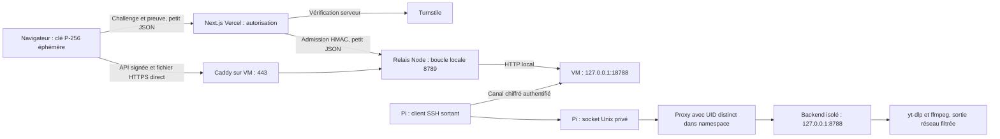

# VidFetch — connexion publique sécurisée préparée

**Décision ultérieure du 12 octobre : Oracle/VPS temporairement abandonné.** Ce document conserve l'étude et les protections validées ; la préparation actuelle vise Funnel avec la passerelle sur le Pi selon [RASPBERRY-FREE-SCALING.md](RASPBERRY-FREE-SCALING.md). Ne pas exécuter ses étapes de création VM/reverse SSH comme si elles étaient encore retenues. L'isolation SSRF, l'authentification et les contrôles avant activation restent nécessaires.

Date de vérification : **12 octobre 2026**. Branche locale : `work/vidfetch-secure-connection-20261012`, issue de `cf8cc173130f9832f2ca776c6fda563e67a6d9fb`. Aucun commit/push, tunnel public, compte externe, changement Vercel/Supabase, SSH vers le Pi ou installation système effectué pendant cette mission.

**Décision : préparer un relais HTTPS sur une petite VM OCI Always Free, avec une liaison SSH sortante du Pi.** Le navigateur reçoit le fichier depuis le relais. Vercel émet seulement une autorisation JSON. La gratuité dépend de l'éligibilité et de la disponibilité du compte ; aucune solution gratuite étudiée n'apporte ici une garantie de disponibilité permanente. L'activation publique reste **BLOQUÉE** jusqu'aux contrôles Linux, fournisseurs et bout en bout décrits ci-dessous.

## 1. Solution recommandée et coût

Le relais ne lance ni yt-dlp ni ffmpeg : Caddy termine HTTPS et un petit serveur Node authentifie, applique les quotas et transporte le flux sans stocker la vidéo. Une VM gratuite peut donc suffire, sous réserve de mesures réelles. La connexion SSH est établie **depuis** le Pi ; aucun port entrant ni transfert de port sur la box.

OCI annonce 10 To sortants/mois dans Always Free. E2.1.Micro fournit 1 Go de RAM, 1/8 OCPU et jusqu'à 50 Mbit/s Internet. Les quotas A1 actuels correspondent à **2 OCPU / 12 Go**, et non aux anciens 4/24. La capacité peut manquer et Oracle peut reprendre une instance inactive. Seules les ressources étiquetées Always Free, dans la région principale et dans les quotas du compte, conviennent à l'objectif zéro abonnement. [Ressources OCI officielles](https://docs.oracle.com/en-us/iaas/Content/FreeTier/freetier_topic-Always_Free_Resources.htm).

Le domaine existant peut fournir un sous-domaine sans achat supplémentaire, si vous le contrôlez. Turnstile a une offre gratuite ; SSH, Caddy et les moteurs déjà présents ne demandent pas d'abonnement. Le coût de connexion domestique et d'électricité subsiste. [Offres Turnstile](https://developers.cloudflare.com/turnstile/plans/).

Si OCI n'est pas disponible, conserver le mode dégradé. Alternative payante à examiner manuellement : un relais Hetzner CX23 européen annoncé à **5,49 €/mois HT hors IPv4**, plus IPv4 **0,50 €/mois HT**, soit **5,99 € HT** avant TVA et éventuels extras. Ce tarif provient de la révision du 15 juin 2026 ; confirmer le devis courant et le trafic inclus avant commande. Aucun achat préparé ou effectué. [Tarifs révisés](https://docs.hetzner.com/general/infrastructure-and-availability/price-adjustment/), [IPv4](https://docs.hetzner.com/cloud/servers/overview/).

## 2. Comparaison des fournisseurs et restrictions

| Option | Coût / quotas vérifiés | Fichiers vidéo/MP3 et taille | Sécurité, installation, fiabilité | Conclusion |
| --- | --- | --- | --- | --- |
| Cloudflare Tunnel public + Access | Tunnel accessible gratuitement ; Access ajoute une politique d'identité | La documentation exclut cet usage vidéo/gros fichiers sur les routes publiques Free/Pro/Business sans service média adapté. Access ne lève pas cette restriction. Pas de plafond de téléchargement inventé à partir des limites d'upload | Installation simple, authentification possible, dépendance au proxy Cloudflare | **Écarté pour les fichiers publics** |
| Tailscale privé + relais VM | Personal gratuit pour usage personnel, 6 utilisateurs ; coût éventuel du relais | Liaison privée adaptée, navigateur public passe toujours par une VM. Débit dépend aussi d'une connexion directe ou relayée | ACL spécifiques indispensables, logiciel supplémentaire sur Pi/VM | Possible, SSH sortant retenu pour réduire les dépendances |
| Tailscale Funnel | HTTPS disponible, ports 443/8443/10000, domaine `ts.net` ; débit plafonné sans seuil numérique garanti publié | Aucun plafond de fichier/volume utilisable comme engagement trouvé dans les pages consultées. Usage public vidéo soutenu et adéquation du plan doivent être confirmés | Authentification applicative à ajouter ; bonne simplicité, capacité publique non garantie | Démonstration possible, **pas de recommandation de capacité publique** |
| ngrok Free | 1 Go sortant/mois, 20 000 requêtes HTTP/mois | Quota trop faible pour un service média ; interstitiel navigateur pour HTML, donc aussi pour la fenêtre d'autorisation | HTTPS/auth possibles ; offre gratuite destinée au développement | Écarté pour l'exploitation publique |
| OCI Always Free + SSH + Caddy | Gratuit sous conditions ; quotas cités en section 1 | Relais HTTP sur VM ; aucun plafond par fichier imposé par ces pages, application limitée à 256 MiB | Auth/quotas à notre charge ; installation plus technique ; récupération d'instances/capacité possibles | **Candidat gratuit retenu, conditionnel** |
| Petit VPS européen Hetzner | Payant ; tarif indicatif section 1, trafic européen généreux, dépassement facturé | Relais de fichiers sans stockage, limite applicative ; pas de plafond HTTP par fichier identifié dans la documentation consultée | Même code/architecture, exploitation prévisible sous réserve du contrat et du devis | Repli à coût minimal, aucune souscription autorisée |
| R2 Standard + Worker d'autorisation | 10 Go-mois, 1 M opérations A, 10 M B gratuits ; sortie Internet R2 gratuite, dépassements/services supplémentaires facturables | Stockage d'objets, transfert Pi→R2 avant disponibilité ; change le streaming actuel. Autorisation atomique supplémentaire nécessaire, une URL S3 signée seule est réutilisable | Bucket privé, Worker + état atomique, nettoyage des objets ; compte avec facturation potentielle | Alternative de stockage, **non implémentée** |

Sources primaires : [Cloudflare Tunnel et médias](https://developers.cloudflare.com/tunnel/concepts/routing/), [politique média et sous-domaines DNS seuls](https://developers.cloudflare.com/fundamentals/reference/policies-compliances/delivering-videos-with-cloudflare/), [Funnel](https://tailscale.com/docs/features/tailscale-funnel), [offres Tailscale](https://tailscale.com/pricing), [conditions Tailscale](https://tailscale.com/terms), [limites ngrok](https://ngrok.com/docs/pricing-limits/free-plan-limits), [R2](https://developers.cloudflare.com/r2/pricing/), [facturation Hetzner](https://docs.hetzner.com/cloud/billing/faq/).

**Portée contractuelle OCI :** les documents d'infrastructure consultés ne montrent pas d'interdiction spécifique comparable au proxy média Cloudflare. Le contrat France consulté prévoit des utilisateurs finaux, du contenu audio/vidéo et une politique interdisant notamment les atteintes aux droits ; l'adéquation du contrat accepté par votre compte doit être vérifiée. Il s'agit d'une conclusion d'architecture conditionnelle, pas d'une autorisation juridique générale de télécharger les contenus de plateformes. Lire le contrat effectivement présenté, ses caractéristiques de service et ses règles de test. [Sélecteur contractuel officiel](https://www.oracle.com/contracts/cloud-services/), [contrat France publié](https://www.oracle.com/contracts/docs/cloud_csa_online_v062223_fr_fra.pdf), notamment articles 1 et 20.

**Vercel Hobby :** compatible techniquement avec le seul petit émetteur JSON préparé. L'offre est limitée à l'usage personnel non commercial ; ses propres quotas continuent à compter pour les appels d'autorisation. Si VidFetch devient commercial/monétisé, réexaminer ce plan avant activation. [Documentation Hobby](https://vercel.com/docs/plans/hobby).

## 3. Architecture et parcours du visiteur



1. Le visiteur passe Turnstile. Le navigateur crée une clé privée WebCrypto P-256 non exportable, conservée en mémoire dans l'onglet.
2. Next.js vérifie la preuve, fait accepter l'admission par le relais avec HMAC/nonce, puis valide le challenge côté Cloudflare (`hostname` exact et `action=vidfetch`). Le secret Turnstile et la clé HMAC restent côté serveur.
3. Next.js émet un grant HMAC de **120 secondes**, lié à la clé publique et à un identifiant de visiteur anonyme. Un cookie Vercel HttpOnly/Secure/SameSite=Strict permet son renouvellement pendant une session absolue de **30 minutes**, sans étendre cette fenêtre à chaque appel.
4. Le navigateur appelle directement le relais pour `/api/health`, `/api/fetch-info`, la préparation et le statut. Chaque preuve ECDSA lie méthode, chemin/query exact, corps, grant, heure et nonce. Le relais rejette les preuves rejouées. Ce protocole applicatif n'est pas présenté comme une implémentation standard RFC DPoP.
5. Le relais garde le ticket Pi interne privé et crée un ticket extérieur aléatoire, lié au visiteur et à l'IP vue par Caddy. Le ticket extérieur expire à **55 secondes**, avant le ticket Pi de 60 secondes, et reste à usage unique.
6. Le bouton ouvre immédiatement une fenêtre sur `/download-helper`. Cette page sans script tiers vérifie l'origine et l'onglet émetteur. Un `postMessage` transmet l'autorisation courte ; un POST signé crée un cookie HttpOnly/Secure/Strict propre au transfert. La fenêtre navigue ensuite sur le téléchargement natif de la même origine.
7. Le navigateur enregistre le flux HTTPS dans son gestionnaire de téléchargements. Pas de `Blob` complet, pas de fichier par Vercel, pas de secret de service dans l'URL ou le JavaScript. Le ticket URL seul ne donne pas accès au fichier sans le cookie lié à l'IP.
8. La fermeture/interruption détruit le flux upstream et les moteurs. Le relais exige aussi la fin réussie de sa réponse avant d'afficher `completed`. Les statuts sont conservés 30 minutes sans renouveler leur rétention à chaque consultation.

L'autorisation anonyme protège les opérations et impose des quotas ; elle **n'identifie pas une personne** ou un utilisateur Supabase connecté. L'IP peut changer avec un VPN ou un réseau mobile : le transfert est alors refusé et doit être préparé à nouveau. Rechargement de l'onglet/perte de la clé/session expirée impose une nouvelle vérification ; les anciens statuts restent stockés mais ne deviennent pas accessibles à ce nouveau visiteur. CORS ne constitue jamais l'authentification.

## 4. Protections préparées et limites

| Contrôle | Mise en œuvre |
| --- | --- |
| Secret entre Vercel et relais | Clé aléatoire 32 octets, HMAC constant-time ; admission datée et à nonce unique ; aucune variable secrète `NEXT_PUBLIC_*` |
| Vol de grant / rejeu | Preuve de possession de la clé navigateur ; copie du grant seule insuffisante ; preuve valable ±30 s, ledger durable de nonces |
| Tickets | 32 octets aléatoires, propriétaire + IP, cookie de transfert dédié, consommation atomique, expiry 55 s, pas de ticket Pi exposé |
| Une opération | Verrou du relais couvrant extraction/préparation/ticket prêt/stream ; verrou backend conservé. Un seul worker final doit être exploité |
| Débit / volume | 2 MiB/s, 256 MiB maximum, 10 minutes préparation+transfert ; limites moteur existantes maintenues |
| Quotas anonymes | 120 appels/min/IP relais ; 20 opérations/10 min/IP et visiteur ; admission 10/min/IP Vercel ; 8 tentatives/jour/IP et visiteur, 1 GiB/jour chacun, 4 GiB/jour global et 100 tentatives globales |
| Réservation de volume | Réservation conservatrice du maximum avant préparation ; remboursement des octets non utilisés ; après crash la réservation reste comptée |
| Mémoire / connexions | Streaming avec backpressure, petits buffers ; métadonnées upstream ≤2 MiB, corps publics ≤8 KiB, 32 connexions, maps/ledger bornés ; Node SQLite intégré, expérimental en Node 22 |
| Durées / processus | Deadlines, idle timeout, abort à déconnexion, fin de pipeline contrôlée, timers nettoyés, groupes de processus existants conservés |
| Journalisation | Pas de corps/URL/grant/cookie dans les logs applicatifs ; IP pseudonymisées dans ledger ; logs d'accès Caddy désactivés et champs de requête/réponse supprimés des logs généraux |
| Mode dégradé | Par défaut, aucune API distante activée et `503 BACKEND_UNAVAILABLE` ; variables invalides/locales ne publient pas d'origine au navigateur |

Ces quotas sont des **limites applicatives**, pas un pare-feu DDoS ni une garantie du quota de facturation global du compte cloud. Les IP pseudonymisées restent des données à protéger ; les compteurs expirent et les nonces sont purgés. SQLite/son répertoire doivent rester privés. La compromission de la page par XSS n'est pas résolue par une clé non exportable : maintenir la sécurité des scripts de la page et de Turnstile. Le navigateur ne peut confirmer au serveur l'écriture physique définitive sur le disque ; `completed` atteste les processus et la réponse HTTP terminés.

### SSRF : condition préalable Linux

Le backend actuel valide des domaines/chemins précis, DNS public et destinations sélectionnées, et utilise `spawn` sans shell. Cela ne contrôle pas toutes les nouvelles résolutions, redirections et requêtes secondaires effectuées par yt-dlp/ffmpeg. **Ne jamais relier le relais public au service actuel non isolé.**

Le futur worker place Node et tous ses enfants dans un namespace dédié avec sortie nftables par défaut refusée : adresses locales/privées/réservées/metadata interdites, IPv6 sortant interdit initialement, DNS public contrôlé, seulement TCP 80/443 publics. Un UID proxy distinct peut joindre le loopback 8788 ; l'UID backend ne le peut pas. Le proxy n'offre qu'un socket Unix privé au client SSH. `ProtectHome`, absence de capacités et `NoNewPrivileges` réduisent également l'accès aux secrets et la possibilité de sortir du namespace.

Le profil root `isolation.json` est une **attestation administrative après audit**, pas une sonde automatique du firewall. Le worker vérifie son propriétaire/mode, UID, inode namespace, capacités et NoNewPrivileges. La passerelle refuse un backend sans `engine.isolationProfile=vidfetch-netns-v1` avec 503 `SECURITY_NOT_READY`. Un administrateur doit produire cette attestation seulement après inspection des règles actives et tests adversariaux sous l'UID backend. Leur efficacité réelle demeure **NON TESTÉE sur Linux** et bloque l'ouverture publique.

## 5. Modifications préparées

- `src/server/download-access.ts`, `access-crypto.ts`, `public-request.ts` et nouvelle route `/api/download-access` : émission différée sans DB, challenge, sessions, HMAC, PoP, contrôle HTTPS JSON avec DNS épinglé, absence de redirections et limites.
- `src/lib/secure-client.ts`, `access-types.ts`, `gateway-origin.ts`, `api.ts` : clé éphémère, appels signés, renouvellement, fenêtre native et origine publique validée.
- `DownloadAccess`, `FetchForm`, `VideoCard`, `EngineBadge` : vérification visiteur, formats existants vidéo/audio conservés, préparation/statuts/erreurs, indicateur de santé ; mode indisponible préservé.
- `next.config.ts` : mode `secure-gateway` opt-in avec readiness, origine HTTPS et site valides ; alias des routes locales indisponibles, aucune DB/yt-dlp/ffmpeg dans les fonctions Vercel. `Dockerfile` copie le helper de configuration supplémentaire.
- `backend/gateway/` : relais Node + ledger SQLite + page de transfert et tests HTTPS/Chrome/média. Aucun nouveau paquet npm.
- `backend/public-worker/` et `secure-relay/` : point d'entrée isolé, proxy Unix et modèles non installés Caddy/SSH/systemd/nftables.
- `backend/server.ts` : ajout ciblé de `-abort_on empty_output` à la conversion MP3. Le test a montré qu'un MP4 avec index final peut produire seulement des tags ID3 avec un exit code ffmpeg 0 ; le futur build refuse maintenant cette sortie sans audio. Pas de repli qui charge la vidéo en RAM. Les sources non compatibles avec un pipe peuvent encore échouer proprement.
- Tests supplémentaires unitaires et `scripts/test-vercel.mjs` adapté à la quatrième route ; documentation et preuves locales privées.

**Le bundle Pi opérationnel n'est pas remplacé**, SHA-256 inchangé : `d370ccfb8574a2f714e86fcde6e555ddd665a846be761ffe29256a648d4a168c`. Le futur worker est un nouvel artefact, à valider séparément sur ARM64. Les sauvegardes avant intervention restent sous `backend/artifacts/secure-connection-20261012-nd1zjwt0/backups/` et dans Git au commit de base. Le service actuel ne reçoit donc pas encore le correctif MP3 supplémentaire.

## 6. Tests réellement effectués et preuves

Les preuves brutes, clés TLS de test et médias générés sont privés/ignorés dans `backend/artifacts/`. Un résumé publiable accompagnera le rapport. Résultats détaillés finaux : [rapport](../REPORT.md), section 21.

| Contrôle | Statut et portée |
| --- | --- |
| ESLint, TypeScript frontend/backend/gateway | **VALIDÉ**, commandes locales sorties 0 |
| Builds Next par défaut et `secure-gateway` | **VALIDÉ**, deux copies sans `.env` et sans `DATABASE_URL`, identité des sources compilées contrôlée |
| Suite unitaire | **VALIDÉ**, 80 tests, notamment origines privées, auth, PoP, body/méthode, quotas persistants, config et DB différée |
| Suite backend existante | **VALIDÉ**, 17 tests HTTP, limites, itérateur, drain, déconnexion, processus, expiration et non-completion sur échec |
| Simulation HTTPS gateway | **VALIDÉ**, TLS avec CA de test explicitement approuvée, 401/auth, admission HMAC/rejeu, propriétaire, ticket volé/réutilisé, 429 concurrence, expiration/rétention accélérées, déconnexion et 503/moteur/isolation absente |
| Chrome entre deux sites HTTPS | **VALIDÉ**, clé WebCrypto, CORS, fenêtre helper, cookie HttpOnly/Secure/Strict, attachement natif exact de 128 000 octets, statut completed ; challenge simulé |
| Vidéo et MP3 par HTTPS avec vrais moteurs Mac | **VALIDÉ**, média original généré de 2 secondes, métadonnées source injectées uniquement au test ; streaming yt-dlp et conversion ffmpeg réels, intégrité vidéo SHA-256, ffprobe et décodage complet, octets/statut/ticket |
| Conversion MP3 vide | **VALIDÉ après correctif**, fixture sans index initial refusée, jamais completed |
| Build HTTP/Chrome dégradé | **VALIDÉ**, santé 200, 8 cas média/access 503, méthodes, concurrence, SEO/mobile, traces sans moteurs/PG, aucune requête API UI, arrêt du serveur temporaire |
| Bundles passerelle/worker + `node --check` | **VALIDÉ sur Mac**, Node 22 CJS, builtin SQLite, shim ffmpeg-static ; chemins Mac et dépendances natives absents des bundles préparés |
| Vrais comptes Turnstile/OCI, certificat public, reverse SSH | **NON TESTÉ**, aucun service externe activé |
| Namespace/nftables/systemd futurs, limites CPU/RAM ARM64 | **NON TESTÉ**, aucun changement au Pi autorisé par cette mission |
| Parcours Internet réel Vercel → VM → Pi → navigateur | **NON TESTÉ**, ne pas annoncer des téléchargements publics opérationnels |
| Ouverture publique maintenant | **BLOQUÉE**, nécessite isolation réseau prouvée, compte/offre disponibles et validation complète |

Échecs initiaux conservés dans les logs : MP3 contenant seulement ID3 ; `fetch` appelé comme méthode d'objet entraînant `Illegal invocation` dans Chrome ; lib TypeScript DOM iterable manquante dans le programme gateway ; cas IPv6 de test mal normalisé. Les trois problèmes de code/configuration ont été corrigés ; le média positif est désormais faststart, et le média négatif non streamable reste testé. Le comportement limité pour les MP4 non seekables est documenté, pas déclaré réparé universellement.

Commandes de maintenance locales, sans activation :

```sh
npm run lint
npm run typecheck
npx tsc -p backend/tsconfig.json
npx tsc -p backend/gateway/tsconfig.json
npm test
npm run test:backend
node backend/gateway/run-tests.mjs
node backend/gateway/run-browser.mjs
# Mac : adapter les chemins moteur si nécessaire ; uniquement fixtures originales
node backend/gateway/run-media.mjs
node backend/gateway/build.mjs backend/artifacts/NEW-gateway.cjs
node backend/public-worker/build.mjs backend/artifacts/NEW-public-worker.cjs
node --check backend/artifacts/NEW-gateway.cjs
node --check backend/artifacts/NEW-public-worker.cjs
```

Les sorties NEW doivent ne pas exister ; les builders refusent de les écraser. SQLite natif Node 22 doit être disponible sur le relais (`node:sqlite`), sans ajout de paquet natif macOS. Pour les tests Chrome, Playwright utilise Chrome installé sur Mac ; la simulation n'assouplit TLS que pour l'empreinte SPKI du certificat de test.

## 7. Comptes externes — procédure manuelle

1. Vérifier l'usage personnel non commercial Vercel Hobby et vos droits sur les médias proposés. Si un changement d'offre est requis, ne pas le souscrire sans décision explicite.
2. Ouvrir Oracle Cloud Free Tier depuis le [site officiel](https://www.oracle.com/cloud/free/faq/), activer MFA, choisir la région principale proche de votre connexion. La vérification d'identité/carte éventuelle relève de votre compte, pas de cette mission.
3. Avant création, contrôler les conditions présentées et l'estimation : uniquement forme/image/boot volume **Always Free**, quotas restants, aucun load balancer, base ou service média supplémentaire. En cas de capacité absente, ne pas basculer automatiquement Pay As You Go. Les alertes de coût ne remplacent pas une limite dure.
4. Préparer une VM E2.1.Micro gratuite si disponible, ou une A1 dans le quota actuel. Réserver un répertoire applicatif neuf et un utilisateur relais non privilégié. Conserver accès administrateur SSH séparé et clés vérifiées.
5. Créer un widget Cloudflare Turnstile gratuit, mode Managed, hostname exact de votre Preview puis hostname final seulement après validation. Ne pas cocher une autorisation pour tous les hostnames. L'action côté code est `vidfetch`. Enregistrer site key et secret key dans votre gestionnaire de secrets. Aucun tunnel/Access n'est nécessaire pour la vidéo retenue.
6. Choisir un sous-domaine du domaine existant pour les téléchargements. Préparer son record vers la VM, **DNS uniquement / nuage gris** si DNS Cloudflare ; ne pas modifier le domaine frontend ou son record Vercel. Ne l'activer qu'après les validations internes ci-dessous.
7. Installer manuellement Node 22 avec SQLite intégré et Caddy sur la VM selon leurs documentations ; cette mission ne réalise aucune installation. Protéger les secrets et la DB quotas avec un répertoire privé. Le relais transporte seulement le flux ; pas de stockage du fichier média.
8. Ouvrir 443 (et 80 si ACME HTTP) sur la VM, jamais sur la box. Restreindre SSH administrateur ; la clé distincte du Pi sert uniquement au forward distant. Les ports 8788/8789/18788 ne doivent jamais apparaître dans une règle ingress publique.

## 8. Raspberry Pi / relais — ordre de préparation, sans activation ici

Les instructions suivantes sont une **future modification réseau et système à autoriser séparément**. Ne pas les appliquer au service actuel ni recopier un modèle avec ses placeholders. Aucun changement du noyau ou redémarrage complet n'est requis par le code préparé ; le support Linux réel doit d'abord être inspecté.

1. Relever l'état des services, ports 8787/8788/SSH, mémoire et règles réseau. Sauvegarder configuration et bundle actuel sans écrasement. Garder une session SSH administrateur ouverte pendant toute future intervention réseau.
2. Créer de nouveaux comptes distincts `vidfetch-public` (moteurs), `vidfetch-proxy` (socket) et `vidfetch-link` (liaison SSH), sans privilèges ni accès aux dossiers personnels du compte `user`. Node/yt-dlp/ffmpeg existants doivent rester installés et exécutables. Ne pas copier de cookies ou proxy secrets de plateformes.
3. Construire/transférer **dans un répertoire neuf** le public-worker, le proxy Unix et les modèles. Conserver l'ancien bundle et l'ancien service intégralement. Faire `node --check` sur ARM64 avant essai.
4. Créer le namespace `vidfetch-egress`, une paire veth et une sortie IPv4 avec NAT strictement limitée à cette paire. Choisir un sous-réseau sans conflit après inspection. La configuration du forwarding/NAT de l'hôte est un changement système non réalisé ici : elle nécessite un plan exact dépendant du réseau réel et votre accord. Ne jamais flusher le ruleset de l'hôte.
5. Rendre disponible `nameserver 1.1.1.1` via `/etc/vidfetch-public/resolv.conf` et le bind-mount du modèle worker ; rejoindre un namespace avec systemd ne réécrit pas automatiquement le resolv.conf de l'application. Installer le modèle nftables **dans le namespace exclusivement**, remplacer `PROXY_UID` par l'UID vérifié du seul proxy. Inspecter les règles effectives, pas seulement le fichier sur disque.
6. Tester les refus sous l'UID backend, et depuis ses enfants réels : loopback, LAN de canary dédié, link-local/metadata, CGNAT, IPv6, redirection public→privé, DNS rebinding contrôlé, manifests/segments secondaires yt-dlp/ffmpeg. Utiliser des canaries de laboratoire sans données personnelles ; ne jamais sonder 8787, SSH ou un vrai service domestique. Vérifier simultanément un accès média public autorisé et les réponses backend au proxy.
7. **Seulement après preuves** créer un fichier root non modifiable par groupe/autres `/etc/vidfetch-public/isolation.json`. Champs attendus : `version`, `backendUid`, `proxyUid`, `namespaceInode`, `rulesVerified`. La version vaut `vidfetch-netns-v1`, les UID sont distincts et non nuls, l'inode correspond au namespace réellement utilisé, `rulesVerified` atteste l'audit terminé. Ne pas fabriquer cette attestation pour contourner un échec. Prévoir de refaire l'audit après toute modification des règles et de retirer l'attestation si la politique n'est plus valide.
8. Adapter `worker.service.example` et `proxy.service.example` dans de **nouvelles** unités. Worker : `VIDFETCH_PUBLIC_WORKER_ENABLED`, `VIDFETCH_ISOLATION_PROFILE`, `YTDLP_PATH`, `FFMPEG_PATH` dans un env privé, chemins Linux réels. Pas de `MemoryMax` sur le Pi tant que le contrôleur mémoire reste absent ; protections compatibles et limites applicatives conservées. Le worker écoute loopback 8788 **dans son namespace**, et le proxy expose seulement `/run/vidfetch-public/backend.sock` au groupe de liaison. RuntimeDirectory systemd retire son propre socket à l'arrêt ; le programme refuse d'écraser un chemin préexistant.
9. Pendant une validation de laboratoire, empêcher tout chevauchement de téléchargements avec l'ancien service. Avant exploitation, après accord séparé, arrêter l'ancien worker local et exploiter un seul worker isolé. Deux backends distincts auraient deux verrous indépendants et violeraient la concurrence globale. Aucun arrêt de ce service n'a été fait ici.
10. Sur VM, préparer un compte SSH `vidfetch-link` dédié. Adapter `sshd-match.example` en drop-in neuf, sauvegarder toute configuration préexistante, contrôler `sshd -t` et `sshd -T -C` pour ce compte avant une future reload **sur la VM seulement**. Clé publique limitée au listen `127.0.0.1:18788`, forwarding distant seulement, aucun shell/TTY/agent/X11/tunnel réseau. Ne pas modifier le sshd du Pi.
11. Créer une clé ED25519 de liaison dédiée sur Pi dans `/var/lib/vidfetch-link`, privée et non affichée ; ne pas réutiliser la clé administrateur du Mac. Vérifier la clé d'hôte VM hors bande et l'épingler dans `known_hosts`, sans `StrictHostKeyChecking=no`. Adapter `link.service.example` et `VM_HOST`. Sa commande future utilise `-R 127.0.0.1:18788:/run/vidfetch-public/backend.sock` ; seul le Pi initie la connexion.
12. Préparer sur VM le bundle gateway dans un dossier neuf, env privé et `gateway.service.example` : boucle 8789, DB durable privée, origine HTTPS, sites exacts et secret partagé. Le backend privé est `http://127.0.0.1:18788`. Ne pas publier ce port. Ne pas ajouter d'option pour désactiver l'isolation en production.
13. Adapter `Caddyfile.example` au hostname contrôlé. Contrôler `caddy validate` et les logs effectifs avant ouverture. Aucun log de requête/ticket/cookie/Authorization ; pas de mode debug ou inspection publique. HTTPS public doit avoir un certificat de confiance, pas une exception TLS de test.
14. Faire un essai privé puis le parcours Preview complet sous contrôle, mesurer RAM/CPU du worker, de ses enfants, du proxy et du SSH, et comparer aux services préservés. Préparer l'arrêt/rollback avant d'activer le DNS/service public.

Les modèles sont des éléments de configuration à relire, pas un installateur automatique. La création du namespace/NAT et sa persistance n'ont pas de script d'activation fourni : les paramètres de l'hôte réel ne sont pas audités pendant cette mission. L'ancien service reste opérationnel et indépendant.

## 9. Variables Vercel et relais

Dans Vercel → projet VidFetch → Settings → Environment Variables, sélectionner **Preview et la branche de travail après un futur push autorisé**, pas Production. Ne pas réutiliser une origine Pi privée. Noms uniquement pour les secrets ; aucune valeur secrète dans cette documentation.

| Variable Vercel | Portée / rôle |
| --- | --- |
| `VIDFETCH_TARGET` | Mode serveur `secure-gateway` lors du futur essai autorisé |
| `VIDFETCH_CONNECTION_READY` | Readiness ; ne passer à `1` qu'après isolation et chaîne privées vérifiées |
| `NEXT_PUBLIC_SITE_URL` | Origine HTTPS exacte de la Preview, puis domaine final après décision séparée |
| `NEXT_PUBLIC_API_ORIGIN` | Origine HTTPS publique du relais, DNS seulement, sans chemin/port exotique |
| `NEXT_PUBLIC_TURNSTILE_SITE_KEY` | Site key publique du widget correspondant au hostname |
| `TURNSTILE_SECRET_KEY` | Secret Vercel uniquement, jamais préfixé NEXT_PUBLIC |
| `VIDFETCH_ACCESS_SIGNING_KEY` | Secret 32 octets aléatoires encodés base64url canonique, partagé avec gateway, jamais affiché/loggé |

`NEXT_PUBLIC_SECURE_GATEWAY` et `NEXT_PUBLIC_DOWNLOADS_UNAVAILABLE` sont dérivées par `next.config.ts`, ne pas les imposer manuellement. Aucune `DATABASE_URL` n'est nécessaire pour cette connexion. Ne pas effacer les variables réellement nécessaires à d'autres fonctions Supabase ; aucune configuration Supabase n'est changée.

Côté VM : `VIDFETCH_GATEWAY_ENABLED`, `VIDFETCH_GATEWAY_ORIGIN`, `VIDFETCH_SITE_ORIGINS`, `VIDFETCH_PRIVATE_BACKEND`, `VIDFETCH_QUOTA_DB`, `VIDFETCH_ACCESS_SIGNING_KEY`. Le même secret ne doit pas être écrit dans Git. `VIDFETCH_GATEWAY_ENABLED=1` active uniquement l'écoute locale du programme ; sa publication HTTPS reste une étape séparée. Générer et conserver les secrets avec un gestionnaire de mots de passe/secrets et fichiers privés, sans les imprimer dans un terminal enregistré.

Pour la future Preview : Build Command `npm run build`, Root Directory racine du dépôt, Output Directory auto Next.js. Après vos variables et un push distinctement autorisé, créer un nouveau déploiement de la branche de travail ; ne pas promouvoir le déploiement actuel ni changer la branche de production. Les variables NEXT_PUBLIC sont figées au build.

**Choisir une URL Preview stable :** lors du futur push autorisé, laisser d'abord cette branche en mode dégradé. Dans Vercel → Deployments → déploiement de cette branche → Domains, relever son alias de branche stable, ou préparer manuellement un domaine Preview stable. Utiliser exactement cette origine pour `NEXT_PUBLIC_SITE_URL`, le hostname Turnstile et `VIDFETCH_SITE_ORIGINS`, puis reconstruire la Preview sécurisée. Ne pas deviner l'alias Vercel ni utiliser un hostname de déploiement éphémère qui change à chaque build. Ouvrir ensuite VidFetch par cet alias configuré ; une autre origine, même une URL Vercel du même projet, sera refusée. Ce choix concerne la Preview uniquement ; le domaine et les variables de production restent inchangés.

## 10. Vérification avant et après ouverture autorisée

1. Vérifier l'offre cloud/contrat, hostname exact, certificat HTTPS et règles ingress VM ; 8788/8789/18788 inaccessibles depuis Internet. Aucun changement de box.
2. Sans grant : santé/extraction/préparation/statut refusés 401 ; le seul helper public n'offre ni information backend ni téléchargement. Une origine étrangère doit être refusée ; CORS reste une défense navigateur complémentaire.
3. Vérifier Turnstile réel côté serveur, hostname/action, ticket challenge réutilisé refusé ; ne jamais capturer ses valeurs dans les preuves publiques. La validation actuelle simule cette étape.
4. Tester grant expiré, mauvaise audience/signature, copie du grant sans clé, PoP rejouée/corps modifié, admission non signée et admission rejouée.
5. Extraire un média individuel public explicitement autorisé ; préparer un format vidéo, puis un MP3. Vérifier menu, nom sûr, gestionnaire natif, octets, ffprobe/décodage et statuts completed. Vérifier dans Network que les **octets média viennent du relais**, jamais de Vercel.
6. Deux visiteurs : seconde opération 429, ticket/status d'un autre propriétaire refusés, cookie/ticket rejoués refusés ; expiry ticket réelle 60 s Pi/55 s relais et rétention statut réelle 30 min. Les nouveaux tests gateway utilisent des durées accélérées ; l'ancienne rétention Pi a déjà été validée séparément.
7. Déconnecter le navigateur pendant préparation et transfert, couper la liaison SSH, interrompre uniquement les nouveaux processus de test. Vérifier statut non completed, disparition de yt-dlp/ffmpeg, timers/quotas libérés et retour 503 si Pi inaccessible.
8. Vérifier limites 256 MiB/10 min/débit/quotas, état ledger après restart, absence de fuite de secret dans logs HTTP/journal/erreurs. Ne pas faire de scan de plateforme cloud ou benchmark sans respecter ses règles de test.
9. Mesurer `/proc`/systemd pour la famille entière Pi : RAM, CPU, durée, enfants, SSH/proxy ; observer au moins une vidéo et un MP3 de taille représentative. **195,6 MiB était une mesure de l'ancien backend**, pas une mesure de cette architecture supplémentaire. Aucun chiffre nouveau Pi n'est annoncé.
10. Vérifier SSH et le service 8787 à l'identique avant/après, sans les démarrer/arrêter. Toute activation finale demande un accord spécifique ; aucune réussite Internet n'est déduite des essais locaux.

## 11. Retour arrière

1. Remettre la Preview en mode dégradé en retirant la readiness puis reconstruire cette Preview, ou revenir au déploiement validé `cf8cc173…`. Aucun changement Supabase ni promotion en production.
2. Arrêter uniquement le nouveau lien SSH et la passerelle préparée ; retirer le record de téléchargement récemment créé après vérification de son identité. Ne pas supprimer de record/domaines Vercel existants.
3. Arrêter les nouveaux worker/proxy. Conserver fichiers, ledger et preuves ; ne pas supprimer les anciennes installations/sauvegardes.
4. Si l'ancien service a été arrêté lors d'une future activation autorisée, le relancer avec sa configuration/bundle sauvegardés, après vérifier un seul worker actif. Confirmer `127.0.0.1:8788`, santé locale et SSH/8787.
5. Retirer seulement les règles/namespace/veth nouveaux dont la propriété a été relevée ; ne pas flusher le firewall hôte. Restaurer le forwarding antérieur seulement après vérifier qu'aucun service ne dépend du nouvel état. Rotation des secrets exposés si incident ; supprimer leurs valeurs uniquement des nouveaux environnements concernés.

**Actions encore à autoriser/exécuter :** création des comptes par vous ; choix de région/offre/domaine ; nouvelle installation/isolations réseau Pi et audit Linux ; VM/Caddy/SSH ; futur push de la branche de travail ; configuration Preview Vercel ; essai Internet complet et éventuelle activation publique. La mission s'arrête avant ces actions.
