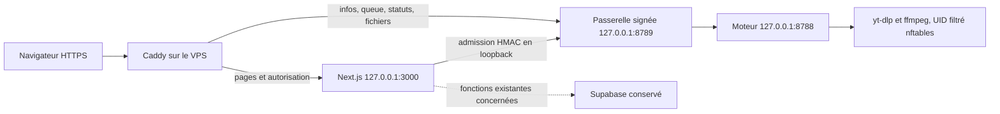

# VidFetch — migration complète OVH, interface et SEO

Rapport du 12 octobre 2026. Cette préparation ne constitue pas une activation publique.

## État et périmètre

**VALIDÉ** : frontend candidat Next.js sur le VPS en loopback, pages et guides, compilation Linux x86_64, contrôles locaux de sécurité, streaming natif vidéo/MP3 via Caddy HTTPS local, arrêt/redémarrage/rollback du frontend. **BLOQUÉ pour la mise en ligne** : accord d'activation, clés CI/CD, secrets Turnstile, vérifications externes et raccordement DNS. Aucun push, aucune fusion, aucune modification Vercel, Supabase, Cloudflare ou Raspberry Pi.

Le checkout initial contenait le travail non commité des missions backend/connexion sécurisée. Il est conservé. La branche de préparation est `work/vidfetch-ovh-full-20261012`, basée sur `cf8cc173130f9832f2ca776c6fda563e67a6d9fb`. Les sources antérieures ont été copiées dans un worktree isolé, puis versionnées avec les changements de cette mission. Le répertoire initial et sa branche restent disponibles.

Checkout de travail : `backend/artifacts/full-migration-20261012-97n1bqjr/checkout`. Les artefacts, médias, clés de test et journaux privés restent ignorés par Git. Les commits préparés sont locaux ; ne pas changer de branche dans le checkout initial avec ses modifications en cours.

## Architecture retenue

Le port 8789 est une passerelle d'autorisation interne nécessaire : le moteur brut sur 8788 ne doit jamais devenir la cible publique du proxy. Cloudflare sera utilisé en **DNS only**, sans transport vidéo par son CDN. Les fichiers passent du VPS au navigateur ; ni Next.js ni les fonctions Vercel ne relaient le média. Vercel et le Pi restent les secours actuels. Aucun service payant supplémentaire créé.

### Routage audité

| Chemin public | Destination | Protection |
|---|---|---|
| `/`, pages plateformes, `/blog`, `/blog/[slug]`, `/legal`, assets | Next.js | Pages statiques/prérendues ; aucune archive publique des téléchargements |
| `/api/health` | Next.js | Santé frontend, contrôle moteur interne lorsqu'activé, sans secret |
| `GET /api/download-access` | Next.js | Configuration publique du widget, aucune clé de service |
| `POST /api/download-access` | Next.js | Origine exacte, challenge serveur, preuve P-256, admission HMAC |
| `/api/fetch-info`, `/api/download`, `/api/queue` | Passerelle 8789 | Grant court, preuve liée à méthode/chemin/corps, nonce anti-rejeu, quotas |
| `/auth/transfer`, `/download-helper` | Passerelle 8789 | Autorisation courte puis cookie HttpOnly/Secure et téléchargement natif |
| `/auth/admission`, `/auth/deployment`, `/internal/*` | Refus Caddy 404 | Service interne uniquement, HMAC même en loopback |
| Autres `/api/*` | Next.js | Aucun wildcard transférant toutes les API au moteur |
| `www.vidfetch.app` | Caddy | Redirection 301 vers `https://vidfetch.app` |

Les routes média Next restent en 503 `BACKEND_UNAVAILABLE` si le proxy manque : aucune exécution implicite d'engines ou initialisation PostgreSQL. Les sources et dépendances des fonctions Supabase existantes restent présentes. Ne configurer `DATABASE_URL` que pour les fonctions qui utilisent réellement la base.

## VPS et services

Debian 13 x86_64, 2 vCPU, 3 826 MiB de RAM, disque 40 Go, aucun swap. Node **22.23.3** et outils existants conservés. yt-dlp **2026.08.19**, distribution décompressée ; ffmpeg/ffprobe **7.1.5**. Caddy **2.11.7**, téléchargement officiel et SHA-256 vérifié, installé comme outil sans serveur public.

| Service | État à cette phase | Compte / limites |
|---|---|---|
| `vidfetch.service` | Installation antérieure, active, inchangée | `vidfetch-worker`, heap 192 MiB, MemoryMax 1 GiB, CPUQuota 150%, 128 tâches |
| `vidfetch-gateway.service` | Installation antérieure, active, inchangée | `vidfetch-gateway`, heap 96 MiB, MemoryMax 256 MiB, CPUQuota 50%, 64 tâches |
| `vidfetch-egress.service` | Inchangé | Filtrage OUTPUT du seul UID moteur, pas de changement INPUT/SSH |
| `vidfetch-web-candidate.service` | Frontend local de validation ; non activé au boot | `vidfetch-web`, heap 256 MiB, MemoryMax 768 MiB, CPUQuota 100%, 96 tâches |
| `vidfetch-web.service` | Configuration préparée, production non activée | Même isolation frontend ; activation après accord |
| `vidfetch-caddy.service` | Configuration préparée ; non démarrée | Futur `vidfetch-proxy`, seule capacité NET_BIND_SERVICE, MemoryMax 192 MiB |
| `vidfetch-migration-*` | Banc temporaire arrêté après tests | Ports supplémentaires tous en loopback ; aucun enfant moteur restant |

Seuls deux comptes dédiés ont été créés : `vidfetch-web` et `vidfetch-deploy`. Le compte CI n'a aucune clé autorisée installée. Son dossier SSH est contrôlé par root ; seuls ses uploads sont modifiables par lui. Sudoers autorise exclusivement le helper de promotion, qui valide tous ses arguments. Aucun shell root, apt ou systemctl général n'est accordé à ce compte.

Caddy public et compte proxy sont préparés pour l'activation future. Les fichiers présents, backups et releases antérieures ne sont pas supprimés. La release volontairement invalide `validation-unhealthy` est conservée comme preuve du rollback.

## Interface et contenus

La marque visible et le domaine affiché sont **VidFetch / vidfetch.app**. La barre d'état moteur a été retirée de l'en-tête ; le composant de supervision et les endpoints sont conservés. Les instructions développeur ont disparu de l'accueil. Le champ de lien reste immédiatement visible, les erreurs apparaissent après une tentative, et le challenge est chargé à la demande. Une autorisation expirée fait réapparaître la vérification.

Accueil simplifié : outil, présentation, trois étapes, choix vidéo/audio, trois guides, liens plateformes, FAQ. Le faux aperçu d'un résultat a été retiré de l'accueil. Aucun chiffre d'utilisation ni avis inventé. Les options réelles de formats, radio clavier, progression, queue et téléchargement sont conservées.

Dix guides anglais originaux, suivant la langue de l'interface existante :

1. `/blog/mp4-vs-webm` — MP4 vs WebM.
2. `/blog/mp3-vs-m4a` — MP3 vs M4A.
3. `/blog/reduce-video-size` — réduire la taille d'une vidéo.
4. `/blog/720p-1080p-4k` — résolutions.
5. `/blog/video-to-audio` — extraire ou convertir l'audio.
6. `/blog/h264-h265-av1` — codecs.
7. `/blog/video-format-smartphone` — format smartphone.
8. `/blog/video-download-fails` — échecs et restrictions.
9. `/blog/bitrate-vs-resolution` — débit et résolution.
10. `/blog/backup-your-videos` — sauvegarder ses propres vidéos.

Fichiers `content/guides/*.md`, métadonnées JSON dans le frontmatter, lecteur Markdown limité sans HTML exécutable. Chaque guide comporte exemples, sections, FAQ, liens internes et sources primaires. Dates de création/mise à jour réelles : **2026-10-12**. `published` reste `null` tant que la publication publique n'est pas effective. Après publication réellement confirmée, `node scripts/ovh/publish-guides.mjs --confirmed-publication` renseigne la date du jour, sans push ni déploiement. Ne pas le lancer à l'avance.

### SEO avant / après

| Point | Avant | Préparation actuelle |
|---|---|---|
| Identité/canonical | Plusieurs références à vidfetch.io | Canonical fixe `https://vidfetch.app`, marque visible corrigée |
| Accueil | Barre technique et répétitions développeur | Outil prioritaire, explications utiles, FAQ et guides |
| Contenu | Quatre pages plateformes et légal | Routes conservées + rubrique et dix guides détaillés |
| Sitemap | Date recalculée à chaque build | Dates de révision stables, guides ajoutés |
| Robots | API exclues | API/auth/helpers/test/staging exclus ; CSS/JS restent accessibles aux robots |
| JSON-LD | WebApplication/FAQ/HowTo | BlogPosting/Breadcrumbs ajoutés ; temps promis et disponibilité fictive retirés |
| 404 | Risque de canonical global hérité | Vraie 404 noindex, pas de canonical racine ajouté globalement |
| Social | Image avec ancien domaine | SVG source corrigé et JPEG v2 ; ancienne image conservée |
| Staging | Risque d'indexation si public | Proxy préparé avec X-Robots-Tag noindex/nofollow par défaut |

Les anciennes adresses e-mail de contact ne sont pas remplacées par des boîtes inventées. Confirmer leurs adresses opérationnelles avant publication. Aucun ancien slug utile n'a changé. Le contrôle SEO n'est pas une preuve d'indexation, de classement ni de résultats enrichis Google.

## Sécurité et limites

- Origin exact, HMAC de service uniquement sur le serveur, clé P-256 non exportable côté navigateur, grant 120 secondes, session HttpOnly/Secure/SameSite Strict à durée absolue 30 minutes.
- Tickets passerelle 55 secondes, tickets moteur 60 secondes, usage unique, liaison au navigateur/à son IP et au cookie de transfert. Statuts 30 minutes, structures bornées. Aucune clé service dans les URL ou le JavaScript public.
- Une tâche média simultanée. Queue FIFO de deux attentes ; attente maximale 180 secondes, claim court ; estimation 90 secondes informative, sans promesse de durée.
- Sortie maximale 256 MiB, durée déclarée 30 minutes, opération maximale 10 minutes, débit sortant applicatif maximal 2 MiB/s. Extraction et opérations ont leurs délais internes existants.
- Quotas existants conservés : huit tentatives/jour par identité IP et propriétaire, 1 GiB/jour ; global cent tentatives/jour et 4 GiB/jour. Débit de requêtes et de travail borné. Ne pas augmenter sans mesures.
- URL strictement reconnue, aucune commande shell construite depuis la saisie. Contrôles DNS/URL et politique noyau du worker : destinations privées/réservées, métadonnées cloud et IPv6 bloquées ; DNS autorisé et sorties HTTP(S) publiques seulement. Redirections et requêtes secondaires restent contraintes par ce filtrage.
- Caddy ne relaie pas les endpoints service, remplace les headers proxy par les valeurs qu'il connaît, limite les corps, ne bufferise pas les fichiers en entier et conserve la propagation d'une déconnexion. Pas de `flush_interval -1` dissociant la requête du client.
- Pas de journal d'accès Caddy contenant les tickets. Le formatter d'erreurs supprime paramètres sensibles et headers d'autorisation/cookies/preuves. Journaux techniques conservés. Rotation dédiée préparée en namespace journald ; configuration globale existante inchangée.
- Aucun firewall INPUT ajouté : SSH et le listener existant 5355 restent inchangés. Les ports applicatifs sont protégés par leur écoute loopback. La configuration d'un firewall public 80/443 sera une action future approuvée, avec conservation explicite de SSH.

## Compilation et CI/CD

Next.js 16.4.0, `VIDFETCH_TARGET=ovh`, `output: standalone`. Build sous Node 22 sur Linux x86_64 ; `public`, `.next/static` et les guides sont inclus. Bundles moteur et gateway CJS node22 compilés avec esbuild 0.25.12 et shim ffmpeg-static, pas de dépendance native macOS. La release comporte environ **82 Mio / 25 Mio compressés** ; chaque fichier est couvert par un manifeste SHA-256. Le VPS n'effectue pas de compilation npm/Next.

`.github/workflows/deploy.yml` : push main ou lancement manuel, permissions contents:read, un déploiement à la fois, actions épinglées sur SHA complets, checkout sans credentials persistants. Build/checks sans secrets de production ; job de déploiement séparé, environnement `production`, autorisé seulement sur main du dépôt officiel et avec `VIDFETCH_DEPLOY_ENABLED=true`.

Le transfert SSH vérifie une liste known_hosts préparée ; aucune désactivation de StrictHostKeyChecking. Une commande forcée accepte seulement `receive COMMIT SHA256`. Upload borné, copie root privée, extraction sans liens/devices/traversal, manifeste exhaustif et limites. Le code des releases s'exécute uniquement comme utilisateurs applicatifs. La promotion se fait par remplacement atomique du lien `current` ; seuls les services modifiés et leurs dépendances nécessaires redémarrent.

Avant changement des moteurs, le helper met la passerelle en maintenance, attend tâche et queue vides, puis vérifie la release et les services. En cas de problème, il restaure le lien précédent et contrôle le retour à la santé. Les cinq releases récentes et la précédente sont conservées ; seuls les anciens dossiers gérés avec nom SHA/manifeste valide sont éligibles à la rétention automatique. Les uploads consommés et le staging créé par ce déploiement sont nettoyés après succès. Les backups manuels et anciennes installations backend sont préservés.

**Limite réelle** : la bascule de fichiers est atomique, mais un restart Next peut provoquer un bref refus de connexion. Ce mécanisme n'est pas une preuve de zéro coupure. Les fichiers en cours ne sont pas interrompus lors d'un déploiement frontend seul ; les mises à jour du moteur attendent la fin des tâches. Une exigence stricte de zéro erreur HTTP nécessitera un frontend blue/green et reload Caddy après validation des deux slots.

## Résultats de validation

| Contrôle | Statut | Preuve |
|---|---|---|
| ESLint et TypeScript | VALIDÉ | Logs locaux et Linux dans le répertoire de preuves |
| Tests unitaires | VALIDÉ | 92 réussis, dont guides, admission loopback, session expirée |
| Backend | VALIDÉ | 17/17 Linux : HTTP, streaming, erreurs processus, timers, concurrence, abort |
| Passerelle HTTPS | VALIDÉ | Deux scénarios locaux incluant auth/owner/replay/expiration/outage/drain |
| Queue / charge synthétique | VALIDÉ | Quatre tests bornés, sans centaines de médias réels |
| Déploiement Python | VALIDÉ | Cinq tests : extraction sûre, checksum, switch, rollback, rétention |
| Build OVH et node --check | VALIDÉ | Builds Linux x86_64 ; aucune DATABASE_URL nécessaire |
| Mode de secours Vercel | VALIDÉ | Build sans DATABASE_URL et contrôles HTTP/browser, aucune modification Vercel |
| Pages/SEO | VALIDÉ | 17 pages 200, un H1, canonical correct, OG/Twitter/JSON-LD, dix guides mobile |
| Robots/sitemap/404 | VALIDÉ | Routes techniques exclues, sitemap cohérent, vraies 404 noindex |
| Vidéo native via navigateur | VALIDÉ, fixture | 4 360 399 octets, completed, compteur identique, ticket refusé au second usage |
| MP3 natif via navigateur | VALIDÉ, fixture | 792 620 octets, completed, 192 kbps, durée 33.024 s |
| Intégrité et décodage | VALIDÉ | SHA identiques aux preuves antérieures ; ffmpeg décode les deux fichiers sans erreur |
| Caddy local TLS / www | VALIDÉ | HTTPS local, redirection 301 canonique, aucune écoute publique |
| Sécurité Caddy et déconnexion | VALIDÉ | Sept contrôles VPS : auth, endpoints privés, replay, owner, concurrence, abort, zéro enfant |
| Restart / crash / rollback frontend | VALIDÉ | Reprise crash 5.87 s ; release invalide refusée, précédente restaurée |
| Backend / gateway / SSH existants | VALIDÉ | PID 9270 / 9271 / 869 inchangés pendant les contrôles |
| npm audit production | VALIDÉ | Zéro vulnérabilité signalée lors du contrôle ; pas une garantie universelle |
| Scanner secrets/fichiers | VALIDÉ | Aucun motif détecté dans les fichiers source contrôlés ; artefacts privés exclus |
| Extraction YouTube sur OVH | ÉCHEC antérieur conservé | 401 AUTH_REQUIRED / anti-bot fournisseur ; aucun contournement tenté |
| Statuts pendant trente minutes en temps réel, nouvelle session | NON TESTÉ | Contrats et tests antérieurs conservés ; pas d'attente de 30 min répétée |
| Vraie redirection distante vers une destination privée | NON TESTÉ ici | Politique noyau et tests de destinations antérieurs conservés ; pas de nouveau serveur de redirection public |
| Certificat public ACME, vrai Turnstile, trafic Internet | NON TESTÉ | Pas de DNS ni d'accès public activé ; challenge fixture simulé |
| Exécution GitHub Actions et connexion CI dédiée | BLOQUÉ | Aucun push et secrets/clé non configurés |
| Bascule domaine / production / démarrage après reboot | BLOQUÉ / NON TESTÉ | Accord requis ; aucun reboot effectué |

Le média est le trailer libre Big Buck Bunny diffusé par W3C : `https://media.w3.org/2010/05/bunny/trailer.ogv`. Les métadonnées sont injectées **dans un entrypoint de test séparé** ; yt-dlp et ffmpeg sont réels, le filtrage UID reste actif. Cela ne prouve pas une extraction YouTube fonctionnelle. Le serveur d'autorisation du banc utilise un challenge simulé, jamais le serveur de production. Les fichiers ont transité par Caddy puis le navigateur, sans Blob vidéo complet.

Empreintes : vidéo `dcbe6f2ea404a52d4b2f6fc91f274874e69be1671a1097eb3dc19f28f7c6e40f`, MP3 `38b23dc423846fff16d0d88950390ace9e9d3152d871ea8d0d0f9f676bd69ecf`.

### Ressources mesurées

Fenêtre de 45.049 secondes comprenant les deux transferts. Maximum combiné instantané des quatre cgroups : **186.35 MiB**. Pics individuels : frontend **67.14**, worker **86.81**, gateway **27.32**, Caddy **15.59 MiB** ; ces pics ne sont pas forcément simultanés. CPU cumulé dans cette fenêtre : respectivement **0.080 / 3.014 / 0.451 / 0.202 seconde**. Pic worker **111.2 % d'un cœur** sur un intervalle d'environ 200 ms ; une limite cgroup sur une période de 100 ms n'interdit pas un dépassement sur un court échantillon.

Réception native vidéo **4.598 s**, MP3 **4.035 s**, incluant préparation, transfert et statut final dans ce scénario. RAM disponible après arrêt du banc : environ **3 394 MiB**, disque libre **36 Go**. Ces mesures d'un court trailer ne valident pas une capacité de production pour des médias longs ou une audience donnée.

Un chargement mobile synthétique (390×844, CPU ×4, 1.6 Mbps, latence 150 ms) : **LCP 372 ms**, **CLS 0.00516**, FCP 336 ms, ressources transférées environ 179 Ko. Le formulaire était visible sans scroll, aucun débordement horizontal ni exception navigateur. **INP terrain, p75 Core Web Vitals et classement SEO non mesurés**.

## Fichiers de maintenance

- `src/components/{Header,Footer,FetchForm,DownloadAccess}.tsx`, `src/lib/{api,secure-client,seo,guides}.ts` : UI et accès.
- `src/server/{download-access,internal-admission,ovh-api}.ts`, routes d'accès : contrôle serveur et mode dégradé.
- `src/app/blog/`, `content/guides/`, `GuideBody.tsx` : contenus versionnés.
- `src/app/{page,layout,sitemap,robots}.tsx/ts`, `public/og-image.svg`, `public/og-image-v2.jpg` : SEO et présentation.
- `next.config.ts`, `scripts/ovh/build-release.mjs` : build autonome Linux.
- `.github/workflows/deploy.yml`, `scripts/ovh/deploy.sh`, `deploy/ovh/*` : unités, proxy et promotion contrôlée.
- `deploy/ovh/validation/`, `scripts/ovh/verify-*.mjs`, tests TS/Python : bancs réservés aux tests, absents des entrypoints de release.
- Les fichiers backend/sécurité/rapports préparés précédemment sont conservés dans la branche, et l'ancien JPEG reste disponible.

## Instructions manuelles — après validation et accord d'activation

Ne pas appliquer ces opérations publiques pendant la phase de préparation. Elles touchent le DNS, les services de production ou les secrets.

### 1. Examiner la branche et les comptes

1. Utiliser le checkout isolé et relire les deux commits de code, ce rapport, les unités et le workflow. Confirmer le domaine et les adresses de contact.
2. Tester une vidéo réellement autorisée de la plateforme que vous souhaitez proposer. Le refus YouTube depuis OVH reste un problème fournisseur à résoudre sans contournement.
3. Vérifier vos moyens de récupération OVH (console) et la clé administrateur existante. Conserver Vercel et le Pi.
4. Sauvegarder les unités et `/etc/vidfetch/*.env` dans un dossier root 0700, sans impression des secrets. Aucun fichier existant ne doit être écrasé sans cette copie.

### 2. Configurer Turnstile et l'authentification serveur

1. Dans Cloudflare, créer ou réutiliser un widget Turnstile pour le seul hostname `vidfetch.app`, action `vidfetch`. Ceci n'active aucun CDN vidéo.
2. Renseigner manuellement `/etc/vidfetch/web.env` (root 0600) : noms `VIDFETCH_TARGET`, `VIDFETCH_CONNECTION_READY`, `NEXT_PUBLIC_SITE_URL`, `TURNSTILE_SITE_KEY`, `TURNSTILE_SECRET_KEY`, `VIDFETCH_ACCESS_SIGNING_KEY`. Utiliser le mode `ovh` et l'origine officielle ; la clé de signature doit être celle du gateway, transférée entre fichiers sur le VPS, sans affichage et sans préfixe NEXT_PUBLIC.
3. Garder CONNECTION_READY à zéro jusqu'aux contrôles. Supabase : conserver ses variables existantes ; `DATABASE_URL` seulement si une fonction réellement dépendante est activée. Aucune fausse URL de base.
4. Sauvegarder puis adapter le gateway à l'origine `https://vidfetch.app`, avec ce site comme origine autorisée exacte. Garder le backend privé `http://127.0.0.1:8788`, la base quotas existante et le mode d'isolation UID. Ne pas ajouter de wildcard ou de domaine Preview arbitraire.

### 3. Installer la première release approuvée en interne

1. Compiler avec les scripts et le runner Linux, ou utiliser l'artefact exact validé. Vérifier SHA archive, manifeste et version Node. Ne pas compiler sur le VPS.
2. Préparer le lien `/opt/vidfetch-web/current` vers la release validée ; conserver la précédente.
3. Installer `deploy/ovh/vidfetch-web.service` comme `/etc/systemd/system/vidfetch-web.service` après vérification/backup. Arrêter seulement `vidfetch-web-candidate.service` avant de prendre le même port 3000.
4. Installer, avec backup, `backend-release.conf` et `gateway-release.conf` comme drop-ins `release.conf` des deux unités existantes. Les autres protections/paths d'engines restent inchangés. Le drop-in gateway active le marqueur de maintenance `/run/vidfetch-deployment/drain`.
5. Faire `daemon-reload`, vérifier les unités, puis démarrer/activer les trois unités VidFetch approuvées. Contrôler leurs ExecStart, UID, loopback, santé, capacité de maintenance et absence d'enfants abandonnés. Aucun reboot requis.
6. La première transition ne peut pas utiliser le helper automatique tant que les anciens services pointent vers leurs chemins historiques : cette installation initiale doit être revue et faite par l'administrateur après accord.

### 4. Installer la clé CI/CD dédiée

1. Sur le Mac, générer une clé ED25519 distincte, par exemple `ssh-keygen -t ed25519 -f ~/.ssh/vidfetch_ovh_ci -C vidfetch-github-actions -N ""`. Ne pas réutiliser `id_ed25519`.
2. Installer seulement sa clé publique dans `/var/lib/vidfetch-deploy/.ssh/authorized_keys`, comme ligne `restrict,command="/usr/local/libexec/vidfetch-ci-dispatch"` suivie de la clé publique. Conserver root comme propriétaire des dossiers SSH et du fichier ; vérifier permissions et backups. Ne changer aucune directive SSH globale.
3. Installer la version finale des helpers root-owned depuis cette branche, avec backups des versions de préparation : `/usr/local/libexec/vidfetch-promote` et `vidfetch-ci-dispatch`. Valider le sudoers fourni avec `visudo -cf`. Le compte CI ne doit pas obtenir d'autre sudo.
4. Vérifier l'empreinte ED25519 du serveur depuis la console OVH et la comparer à la clé connue du Mac. Préparer le contenu known_hosts exact pour `15.235.127.165` ; un simple keyscan réseau non vérifié n'est pas une preuve d'identité.
5. Tester la commande forcée : un shell ou une commande arbitraire doit être refusé. Le helper doit refuser tout déploiement tant que son marqueur root d'approbation manque.

### 5. Configurer GitHub manuellement

1. Settings → Environments → créer `production`. Dépôt public : demander une revue avant déploiement et limiter à `main`. Ne pas activer « Prevent self-review » si vous êtes l'unique approbateur nécessaire.
2. Ajouter les secrets **OVH_DEPLOY_SSH_KEY** et **OVH_DEPLOY_KNOWN_HOSTS**. Valeurs non fournies dans ce rapport. Aucun secret Supabase ou clé de service n'est nécessaire au job de build.
3. Ajouter la variable **VIDFETCH_DEPLOY_ENABLED**, initialement `false`. Les hôte et compte CI sont fixés dans le script.
4. Protéger main et effectuer une revue des changements. Un push/merge GitHub nécessite une nouvelle autorisation ; aucun n'a été réalisé. Attention : l'intégration Vercel existante peut aussi déployer à partir de GitHub. Examiner ce comportement avant toute fusion, sans modifier ses réglages pendant cette mission.
5. Après contrôle des secrets, de la première installation et du rollback, écrire **APPROVED** dans `/etc/vidfetch/full-migration-ready` (root-owned, non modifiable par les groupes/autres). Ce marqueur n'existe pas actuellement. Puis activer la variable GitHub à `true`.
6. Autoriser un premier lancement du workflow sur main et vérifier build, transfert, health et résultat/rollback dans Actions. Tant qu'il n'a pas réellement tourné, le CI/CD distant reste NON TESTÉ.

### 6. Raccorder DNS et HTTPS après accord public

1. Exporter les enregistrements Cloudflare actuels pour rollback. Noter A/AAAA/CNAME et TTL ; ne pas laisser un ancien AAAA envoyer des visiteurs ailleurs.
2. Après autorisation, préparer A `vidfetch.app` vers l'IPv4 VPS et CNAME `www` vers le domaine canonique, **DNS only**. Réduire le TTL avant bascule si votre configuration le permet.
3. Créer le compte non privilégié `vidfetch-proxy`, installer le Caddyfile revu et l'unité proxy préparée, avec backup si un fichier existe. Configurer seulement les dossiers d'état dont Caddy a besoin. Garder les ports 3000/8788/8789 en loopback.
4. Si un firewall OVH/local exige une règle HTTP(S), faire valider séparément l'ouverture 80/443 en conservant SSH ; ne jamais activer un deny global improvisé.
5. Activer Caddy seulement après accord d'exposition. L'ACME ne sera validé qu'une fois le domaine dirigé correctement. Vérifier le certificat public et le 301 www. Garder noindex pendant la recette.
6. Passer CONNECTION_READY à un, tester le vrai Turnstile et les refus 401/403/429, puis vidéo/MP3 autorisés depuis un réseau externe. Vérifier statut/bytes, fin de fichier, ticket consommé, expiration et déconnexion. Aucun succès public annoncé avant ce contrôle.
7. Après validation, retirer le header staging X-Robots-Tag en réglant `VIDFETCH_ROBOTS_HEADER` à une valeur autorisant l'indexation, puis reload Caddy. Contrôler canonical, sitemap, robots et 404 par HTTPS. Renseigner les dates de publication réellement effectives dans les guides et faire tester le commit suivant.
8. Une fois tout ceci autorisé et validé, les nouveaux push main passent par le pipeline automatique. Ne pas supprimer le secours Vercel/Pi pendant la stabilisation.

## Retour arrière

- En cas d'échec de health pendant une promotion : lien previous restauré automatiquement, mêmes services ciblés redémarrés et santé contrôlée. Une erreur de rollback est signalée explicitement ; ne pas multiplier les déploiements.
- Retour à une release conservée : d'abord bloquer de nouvelles tâches et attendre les transferts, relever la release courante et son backup, basculer atomiquement `current`, redémarrer uniquement les services concernés, vérifier les trois santés et le média. L'ancien dossier de backend `/opt/vidfetch/releases/` reste disponible hors rétention de la nouvelle application.
- Avant tout retour global, remettre le DNS exactement à son export Vercel initial et retirer l'intégration OVH active. Ne pas deviner d'anciennes IP Vercel ; utiliser le backup.
- Fermer la variable GitHub de déploiement et préserver les preuves en cas d'incident. Ne jamais toucher au Pi, à ses services ou à Supabase pour ce rollback.
- Le frontend candidat peut être arrêté séparément avec `sudo systemctl stop vidfetch-web-candidate.service` ; il n'est pas activé au démarrage. Les services backend originaux restent indépendants tant que les drop-ins de production ne sont pas installés.

## Références officielles consultées

[Next.js self-hosting](https://nextjs.org/docs/app/guides/self-hosting), [standalone et fichiers à inclure](https://nextjs.org/docs/app/api-reference/config/next-config-js/output), [GitHub Actions — sécurité](https://docs.github.com/en/actions/reference/security/secure-use), [environnements de déploiement](https://docs.github.com/en/actions/reference/workflows-and-actions/deployments-and-environments), [Caddy reverse proxy](https://caddyserver.com/docs/caddyfile/directives/reverse_proxy), [Caddy 2.11.7](https://github.com/caddyserver/caddy/releases/tag/v2.11.7), [Google — JavaScript SEO et ressources crawlables](https://developers.google.com/search/docs/crawling-indexing/javascript/javascript-seo-basics), [Schema BlogPosting](https://schema.org/BlogPosting), [définition Core Web Vitals](https://web.dev/articles/defining-core-web-vitals-thresholds). Les sources techniques de chaque guide sont également présentes dans ses métadonnées.
